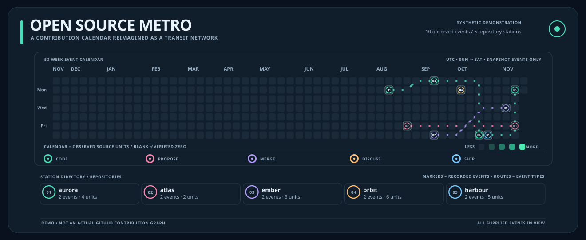
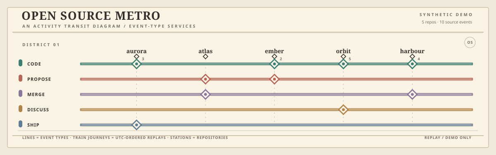

# GitHub Activity Studio

## Open Source Metro | Branch preview

**Two transit-map designs, built from synthetic demonstration data.** This gallery is shown **only on the `concept/open-source-metro` branch** while the concept is under review. It is not the owner's real GitHub contribution activity.

### Contemporary metropolitan map

[View animated metropolitan map](concepts/open-source-metro/exports/modern-dark.svg) · [Open concept documentation](concepts/open-source-metro/README.md)

### Refined vintage transport diagram

[View animated vintage map](concepts/open-source-metro/exports/vintage-light.svg) · [Open local browser preview](concepts/open-source-metro/exports/preview.html)

### Extended network test: 17 stations

**How to interpret the map:** Stations represent repositories, and coloured routes represent recorded event categories: commits, PRs opened, PRs merged, issues opened and releases. Animated trains follow UTC event order. Route sharing does not imply an actual relationship between repositories.

**Viewing note:** GitHub renders the still SVGs above. Animated SVG motion may be blocked or stripped by GitHub's image proxy; open a raw SVG in a browser, or run the offline [browser preview](concepts/open-source-metro/README.md#windows-run-from-a-fresh-clone) for dependable animation and design controls. GitHub does not run JavaScript inside repository HTML previews.

[Review Draft PR #4](https://github.com/AdityaSreevatsaK/GitHub-Activity-Studio/pull/4)

---

Five original, independently developed GitHub activity visualisations. Explore them, compare the results, then select one for a personal GitHub profile or develop a reusable open-source tool.

**Status:** concept exploration. No design is selected, released, or installed on a GitHub profile.

| Concept | Concept brief | Working directory | Development branch |
| --- | --- | --- | --- |
| GitHub Constellation | [Brief](docs/prompts/01-constellation.md) | `concepts/constellation/` | `concept/constellation` |
| Code Factory | [Brief](docs/prompts/02-code-factory.md) | `concepts/code-factory/` | `concept/code-factory` |
| Agent Swarm | [Brief](docs/prompts/03-agent-swarm.md) | `concepts/agent-swarm/` | `concept/agent-swarm` |
| Open Source Metro | [Brief](docs/prompts/04-open-source-metro.md) | `concepts/open-source-metro/` | `concept/open-source-metro` |
| Developer World | [Brief](docs/prompts/05-developer-world.md) | `concepts/developer-world/` | `concept/developer-world` |

## Working agreement

- Every concept has its own branch and directory. Work should be submitted through a **draft pull request**. No merging without explicit approval.
- Start by reading [AGENTS.md](AGENTS.md), the [shared data contract](docs/DATA_CONTRACT.md) and the appropriate concept brief.
- Build a useful preview from labelled demonstration data, plus a reproducible export suitable for a GitHub README.
- Prefer a compact, tasteful design to dashboards, generic statistic cards or ornamental images.
- Never modify the owner's profile repository or claim that a demonstration is real GitHub activity.
- Keep the Windows setup simple, security conscious, tested and inexpensive.

## Selection criteria

Compare the five candidates for visual identity, immediate clarity, animation quality, accurate representation of real activity, GitHub README rendering, accessibility, output size, maintenance burden and reuse by other GitHub users.

The final design is intentionally undecided. The concept briefs are design targets, not evidence of implementation.
