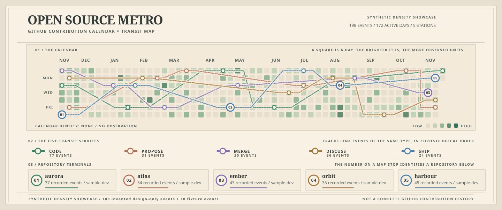

# GitHub Activity Studio

## Open Source Metro | Enhanced calendar-first visual

The redesigned **Metro Atlas** preserves the recognisable GitHub contribution grid while making the five activity routes and repository stops more prominent. These are **synthetic design previews**, not the owner's actual contribution history.

**Modern Metropolitan (invented demo events, explicitly labelled)**

**Vintage Transit (the same invented demo events)**

**The exact shared fixture, without any invented history**

**How to read:** squares are days; brighter greens mean more observed source units; lines connect dated activity *of the same type*; numbered stops identify repositories beneath the map.

[Technical documentation](concepts/open-source-metro/README.md) · [Draft PR #4](https://github.com/AdityaSreevatsaK/GitHub-Activity-Studio/pull/4)

---

## Open Source Metro | Contribution calendar × transit network

**Concept 04, shown only on this branch.** The original standalone route diagram has been redesigned around the **GitHub-style 53-week × 7-day contribution grid**. Coloured metro services connect real dates from the supplied synthetic fixture, and numbered station markers identify repositories. **All events shown are synthetic demonstration data, not the owner's GitHub history.**

### Contemporary metropolitan: Midnight

### Refined vintage transport: Parchment

### Stress preview: 17 synthetic stations

**How to read it:** A coloured route denotes one event kind (commits, PRs opened, PRs merged, issues opened or releases), and each station stop is on a dated source event. Green cells show **observed units in the supplied snapshot**, not GitHub's complete contribution count. Blank days are **unknown, not verified zero contributions**. No line claims relationships between repositories.

[Full design explanation and Windows instructions](concepts/open-source-metro/README.md) · [Animated contemporary SVG](concepts/open-source-metro/exports/modern-dark.svg) · [Animated vintage SVG](concepts/open-source-metro/exports/vintage-light.svg) · [Draft PR #4](https://github.com/AdityaSreevatsaK/GitHub-Activity-Studio/pull/4)

**GitHub view:** Still SVGs above are appropriate for rendered README previews. Browser controls require running the local generator. GitHub image-proxy playback of SVG motion is not guaranteed.

---

Five original, independently developed GitHub activity visualisations. Explore them, compare the results, then select one for a personal GitHub profile or develop a reusable open-source tool.

**Status:** concept exploration. No design is selected, released, or installed on a GitHub profile.

| Concept | Concept brief | Working directory | Development branch |
| --- | --- | --- | --- |
| GitHub Constellation | [Brief](docs/prompts/01-constellation.md) | `concepts/constellation/` | `concept/constellation` |
| Code Factory | [Brief](docs/prompts/02-code-factory.md) | `concepts/code-factory/` | `concept/code-factory` |
| Agent Swarm | [Brief](docs/prompts/03-agent-swarm.md) | `concepts/agent-swarm/` | `concept/agent-swarm` |
| Open Source Metro | [Brief](docs/prompts/04-open-source-metro.md) | `concepts/open-source-metro/` | `concept/open-source-metro` |
| Developer World | [Brief](docs/prompts/05-developer-world.md) | `concepts/developer-world/` | `concept/developer-world` |

## Working agreement

- Every concept has its own branch and directory. Work should be submitted through a **draft pull request**. No merging without explicit approval.
- Start by reading [AGENTS.md](AGENTS.md), the [shared data contract](docs/DATA_CONTRACT.md) and the appropriate concept brief.
- Build a useful preview from labelled demonstration data, plus a reproducible export suitable for a GitHub README.
- Prefer a compact, tasteful design to dashboards, generic statistic cards or ornamental images.
- Never modify the owner's profile repository or claim that a demonstration is real GitHub activity.
- Keep the Windows setup simple, security conscious, tested and inexpensive.

## Selection criteria

Compare the five candidates for visual identity, immediate clarity, animation quality, accurate representation of real activity, GitHub README rendering, accessibility, output size, maintenance burden and reuse by other GitHub users.

The final design is intentionally undecided. The concept briefs are design targets, not evidence of implementation.
