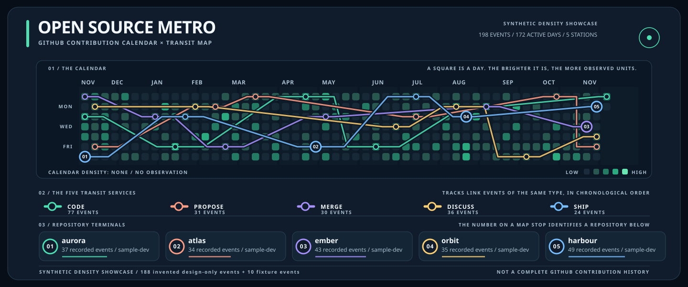
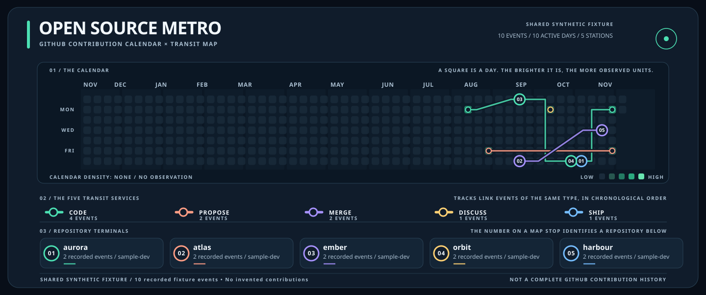

# GitHub Activity Studio

## Open Source Metro | Enhanced calendar-first visual

The redesigned **Metro Atlas** preserves the recognisable GitHub contribution grid while making the five activity routes and repository stops more prominent. These are **synthetic design previews**, not the owner's actual contribution history.

**Modern Metropolitan (invented demo events, explicitly labelled)**

**Vintage Transit (the same invented demo events)**

**The exact shared fixture, without any invented history**

**How to read:** squares are days; brighter greens mean more observed source units; lines connect dated activity *of the same type*; numbered stops identify repositories beneath the map.

[Technical documentation](concepts/open-source-metro/README.md) · [Draft PR #4](https://github.com/AdityaSreevatsaK/GitHub-Activity-Studio/pull/4)

---

### Previous Metro prototype

The earlier, sparsely populated design remains available for comparison in the [concept archive and generator documentation](concepts/open-source-metro/README.md#earlier-calendar-metro-prototype). The new Metro Atlas illustrations above are the current exploration.

---

Five original, independently developed GitHub activity visualisations. Explore them, compare the results, then select one for a personal GitHub profile or develop a reusable open-source tool.

**Status:** concept exploration. No design is selected, released, or installed on a GitHub profile.

| Concept | Concept brief | Working directory | Development branch |
| --- | --- | --- | --- |
| GitHub Constellation | [Brief](docs/prompts/01-constellation.md) | `concepts/constellation/` | `concept/constellation` |
| Code Factory | [Brief](docs/prompts/02-code-factory.md) | `concepts/code-factory/` | `concept/code-factory` |
| Agent Swarm | [Brief](docs/prompts/03-agent-swarm.md) | `concepts/agent-swarm/` | `concept/agent-swarm` |
| Open Source Metro | [Brief](docs/prompts/04-open-source-metro.md) | `concepts/open-source-metro/` | `concept/open-source-metro` |
| Developer World | [Brief](docs/prompts/05-developer-world.md) | `concepts/developer-world/` | `concept/developer-world` |

## Working agreement

- Every concept has its own branch and directory. Work should be submitted through a **draft pull request**. No merging without explicit approval.
- Start by reading [AGENTS.md](AGENTS.md), the [shared data contract](docs/DATA_CONTRACT.md) and the appropriate concept brief.
- Build a useful preview from labelled demonstration data, plus a reproducible export suitable for a GitHub README.
- Prefer a compact, tasteful design to dashboards, generic statistic cards or ornamental images.
- Never modify the owner's profile repository or claim that a demonstration is real GitHub activity.
- Keep the Windows setup simple, security conscious, tested and inexpensive.

## Selection criteria

Compare the five candidates for visual identity, immediate clarity, animation quality, accurate representation of real activity, GitHub README rendering, accessibility, output size, maintenance burden and reuse by other GitHub users.

The final design is intentionally undecided. The concept briefs are design targets, not evidence of implementation.
