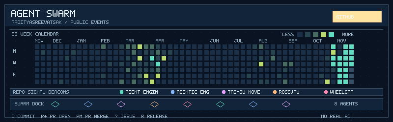

# Agent Swarm

A pair of original, deterministic **visual metaphors** of GitHub activity. Eight specialised helpers, paired as couriers and builders, travel across a recognisable **53-week contribution-style calendar**, co-ordinating on recorded event days. Repository beacons remain secondary. **No LLM calls, no autonomous agents performing GitHub actions, and no write access.**

| Primary design | Alternative |
| --- | --- |
| **Geometric:** luminous activity cells, elegant paths and geometric swarm choreography | **Mini robots:** expressive helpers, charging docks and miniature task-cell workshops |

The account-specific exports use verified public records. All separate sample data is clearly marked **synthetic demo**.

## Your account: @AdityaSreevatsaK

These animations use **your actual publicly visible GitHub activity**, recorded on 17 November 2026. Events include public PR openings and merges, issues you opened, and commits authored by you on public repository default branches. No fictional events appear in these two animations.

### Geometric Agent Swarm (your account)

### Miniature Robot Swarm (your account)

[Geometric still](exports/account/geometric-dark-still.svg) · [Robot still](exports/account/robots-light-still.svg)

**Coverage:** This is a calendar of **observed public events**, not GitHub's authoritative contribution-heatmap totals. GitHub may omit private activity, commits on other people's branches, and other contribution types from these collected sources. A blank square means no matching *collected* public event, not inactivity. Each contribution/task shown is backed by a GitHub URL in [the committed account snapshot](data/adityasreevatsak-public.json).

To inspect the account preview on Windows, run the server and open **http://127.0.0.1:8000/preview.html?source=account**.

## Separate synthetic examples

The canonical ten-event fixture and the fictional 327-event showcase are retained **only for tests and design comparison**, clearly labelled as demonstration data.

**Synthetic geometric fixture**

**Synthetic robot fixture**

## Calendar interpretation

The 53-week, seven-day grid is **date-accurate for events present in the normalised input snapshot**. It is **not** GitHub's complete contributions graph. Intensity represents the number of **distinct recorded source events** per day, not a verified GitHub contribution total. Blank cells mean *no events in the provided snapshot*, **not** zero contributions. The calendar can display events from all repositories in the input, whilst the animated swarm selects up to five recently active repository beacons and ten sampled source events. Animations target source-backed calendar dates; the 14-second replay remains a visual metaphor.

## A richer, explicitly fictional visual showcase

The separate testing fixture remains the shared, ten-event synthetic demonstration dataset. For design evaluation, there is a separate **synthetic showcase** with 327 deterministically generated demonstration events across 187 days. It is visibly labelled **SYNTHETIC SHOWCASE**, and **does not represent your actual GitHub contribution history**. Its higher activity density makes the swarm choreography easier to judge.

**Geometric showcase:**

**Miniature-robot showcase:**

[See the dedicated showcase gallery](showcase.html). Both designs use exactly the same simulated source events and source-backed task mapping. Account-specific assets are generated from a checked-in public snapshot. The synthetic gallery is deliberately separate.

## Refresh your public account snapshot

To update the dated real-data artwork from public GitHub only (Node.js 20+, no packages):

~~~powershell
node concepts/agent-swarm/refresh-account.mjs
node concepts/agent-swarm/build.mjs --account
node concepts/agent-swarm/build.mjs --account --verify
~~~

The collector uses the official GitHub public REST endpoints for PRs, issues and default-branch commits. An optional read-only `GITHUB_TOKEN` environment variable helps with GitHub rate limits, but no credentials are written to files or required for offline tests. The collector refuses partial API results and writes the updated JSON only when collection succeeds. It **never** requests private repositories or changes GitHub data.

Commit the refreshed JSON and generated account exports to the feature branch after reviewing them. The artwork remains a dated public-activity snapshot, not the complete official GitHub contributions grid.

## Windows: start to finish

**Beforehand:** install [Node.js 20 or later](https://nodejs.org/) and clone or download this repository. No tokens or extra packages are needed.

1. Open **PowerShell** in the GitHub-Activity-Studio repository.
2. Generate preview assets and GIF animations:

~~~powershell
node concepts/agent-swarm/build.mjs
node concepts/agent-swarm/build.mjs --verify
node concepts/agent-swarm/build.mjs --account
node concepts/agent-swarm/build.mjs --account --verify
~~~

3. Start the private local preview server (the build also regenerates the optional synthetic showcase assets):

~~~powershell
node concepts/agent-swarm/serve.mjs
~~~

4. Open **http://127.0.0.1:8000/** (or **http://127.0.0.1:8000/showcase.html** for the richer fictional gallery). Switch design and theme, pause/replay, scrub the timeline, inspect date cells with the mouse or use the keyboard-accessible recorded-day selector. Press **Ctrl+C** to stop.
5. Run tests in another PowerShell window:

~~~powershell
node --test concepts/agent-swarm/tests/scene.test.mjs concepts/agent-swarm/tests/calendar.test.mjs concepts/agent-swarm/tests/showcase.test.mjs concepts/agent-swarm/tests/exports.test.mjs concepts/agent-swarm/tests/server.test.mjs concepts/agent-swarm/tests/preview.test.mjs concepts/agent-swarm/tests/collector.test.mjs concepts/agent-swarm/tests/account.test.mjs
~~~

To use a different, already-normalised public snapshot:

~~~powershell
node concepts/agent-swarm/build.mjs --input .\path\to\activity.json
~~~

You can specify --out for a custom export directory. The browser preview reads from this concept's default exports directory.

The `--verify` command checks all generated files byte-for-byte without changing them. It exits with an error if an asset is missing or stale. Run it after editing the renderer or the source fixture.

## Outputs

- exports/account/{geometric,robots}-{dark,light}.gif: your public GitHub account activity.
- exports/{geometric,robots}-{dark,light}.gif: four self-contained looping 14-second GIFs for GitHub READMEs.
- exports/geometric-dark.svg, geometric-light.svg, robots-dark.svg and robots-light.svg: detailed 14-second animated SVGs.
- exports/{geometric,robots}-{dark,light}-still.svg: four matching static, accessible alternatives.
- exports/scene.json: the precise input-derived event choreography. The browser uses this for its phase inspector.

Sample markdown (only use after reviewing the design):

~~~markdown

~~~

GIF is supported as an image format in GitHub READMEs. Animated SVGs may behave differently when served via GitHub's image proxy. **Actual rendered GitHub README verification has not yet been performed.** Neither design has been installed on any profile.

## Trustworthy mapping

Each observed GitHub event corresponds to **one** symbolic task, not one task per commit. The event timestamp selects a calendar cell; its repository becomes a secondary beacon. The kind determines a separate glyph: commit (C), PR opened (P+), PR merged (PM), issue opened (?), release (R). Its count appears explicitly as source-backed **units within the packet**, never disguised as commits. Each task pairs a **courier** that carries the symbolic event packet with a **builder** that processes it at the recorded-day cell. Both return to the dock. State transitions are queued → assigned → travelling → working → complete → delivered. The entire sequence is a metaphor; the original events were not made by AI agents, and its compressed timeline does not represent actual elapsed time.

The calendar covers **53 weeks** of observed events, while at most **five** recently active repository beacons and **ten latest** event packets are animated. Clipping and out-of-window events are disclosed. Other repository histories are not inferred or invented. Source event IDs are deduplicated, and names are escaped. Empty data, one repository, missing optional metadata, bursty load, long names, invalid input and stale snapshots are handled. A 30-day stale warning is relative to the snapshot's generated timestamp. The account snapshot was collected from public GitHub searches and authored default-branch commits; it is a dated snapshot, not a live streaming connection.

## Technical notes and trade-offs

- Engine: standalone deterministic Node.js ES modules, standard library only. Calendar and GIF implementations live in `calendar.mjs` and `calendar-gif.mjs`. No API calls, paid providers, tokens or third-party fonts.
- Data: the repository's shared/fixtures/demo-activity.json. The normalised contract is documented in docs/DATA_CONTRACT.md. No independently developed collector or invented activity data.
- Geometry: bright recorded-day cells, controlled routes, event halos, and repository beacons. Mini robots add face screens, antennae, charging docks, faint links between adjacent observed days, busy-day markers and paired approaches to activity cells. Both remain recognisable as calendar graphs.
- Exports: detailed SVG and simplified pixel GIF from the **same calendar and task schedule**, not pixel-identical files. A native LZW encoder avoids extra dependencies.
- Accessibility: descriptive SVG titles, descriptions, event-intensity legend, demo label, keyboard-operable recorded-date inspection, pause/replay controls and static fallbacks. Reduced-motion preferences initially pause the browser animation. GIFs have no automatic reduced-motion adaptation; use the matching still for each style/theme when necessary.
- The preview server binds to 127.0.0.1 and only serves two preview pages and generated media. It denies arbitrary source, .env files, malformed paths and symlink escapes. The inspector uses textContent, and export text is escaped.
- Tests cover validation, determinism, deduplication, state transitions, agent assignment conflicts, truncation, provenance, escaping, themes, rendering and GIF integrity.

**Before a profile release:** review readability at small sizes, inspect an actual GitHub README render, compare GIF sizes/contrast and decide which theme/design to keep. Leave master and all other concepts untouched.
