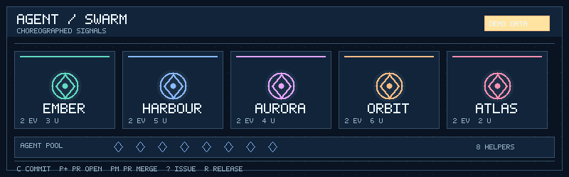
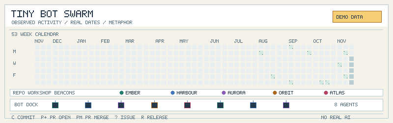

# Agent Swarm

A pair of original, deterministic **visual metaphors** of GitHub activity. Eight symbolic helpers relay event packets to labelled repository hubs. **No LLM calls, no autonomous agents performing GitHub actions, and no write access.**

| Primary design | Alternative |
| --- | --- |
| **Geometric:** restrained shapes, signals and orbital choreography | **Mini robots:** friendly little helpers and workshop bays |

All sample data is explicitly marked **synthetic demo**.

## Watch the animations directly on GitHub

These are **synthetic demonstration data**, not the owner's real GitHub contributions. Both GIFs are embedded below so they can be inspected in GitHub's rendered README without running anything locally.

### Geometric swarm (primary)

### Miniature robot swarm (alternative)

If animations are disabled, see the [geometric still](exports/geometric-dark-still.svg) and [robot still](exports/robots-light-still.svg). **These animations are visual metaphors, not real AI agents.**

## Windows: start to finish

**Beforehand:** install [Node.js 20 or later](https://nodejs.org/) and clone or download this repository. No tokens or extra packages are needed.

1. Open **PowerShell** in the GitHub-Activity-Studio repository.
2. Generate preview assets and GIF animations:

~~~powershell
node concepts/agent-swarm/build.mjs
~~~

3. Start the private local preview server:

~~~powershell
node concepts/agent-swarm/serve.mjs
~~~

4. Open **http://127.0.0.1:8000/**. Switch design and theme, pause/replay, scrub the timeline or inspect events. Press **Ctrl+C** to stop.
5. Run tests in another PowerShell window:

~~~powershell
node --test concepts/agent-swarm/tests/scene.test.mjs
~~~

To use a different, already-normalised public snapshot:

~~~powershell
node concepts/agent-swarm/build.mjs --input .\path\to\activity.json
~~~

You can specify --out for a custom export directory. The browser preview reads from this concept's default exports directory.

## Outputs

- exports/geometric-dark.gif and exports/robots-light.gif: real, self-contained looping 14-second GIFs for a GitHub README.
- exports/geometric-dark.svg, geometric-light.svg, robots-dark.svg and robots-light.svg: detailed 14-second animated SVGs.
- exports/geometric-dark-still.svg and robots-light-still.svg: static, accessible alternatives.
- exports/scene.json: the precise input-derived event choreography. The browser uses this for its phase inspector.

Sample markdown (only use after reviewing the design):

~~~markdown

~~~

GIF is supported as an image format in GitHub READMEs. Animated SVGs may behave differently when served via GitHub's image proxy. **Actual rendered GitHub README verification has not yet been performed.** Neither design has been installed on any profile.

## Trustworthy mapping

Each observed GitHub event corresponds to **one** symbolic task, not one task per commit. Its source repository becomes a hub. The kind determines a separate glyph: commit (C), PR opened (P+), PR merged (PM), issue opened (?), release (R). Its count appears explicitly as source-backed **units within the packet**, never disguised as commits. Two numbered illustrative helpers travel to a hub, perform an abstract collaborative transformation, and return to the dock. State transitions are queued → assigned → travelling → working → complete → delivered. The entire sequence is a metaphor; the original events were not made by AI agents, and its compressed timeline does not represent actual elapsed time.

The visual window shows at most **five** recently active repository hubs and the **ten latest** eligible event packets. Clipping is disclosed. Other repository histories are not inferred or invented. Source event IDs are deduplicated, and names are escaped. Empty data, one repository, missing optional metadata, bursty load, long names, invalid input and stale snapshots are handled. A 30-day stale warning is relative to the snapshot's generated timestamp.

## Technical notes and trade-offs

- Engine: standalone deterministic Node.js ES modules, standard library only. No API calls, paid providers, tokens or third-party fonts.
- Data: the repository's shared/fixtures/demo-activity.json. The normalised contract is documented in docs/DATA_CONTRACT.md. No independently developed collector or invented activity data.
- Geometry: smooth, aligned arcs and restrained hubs with consistent visual encoding. Mini robots: separate robot silhouettes, antennae, face screens and playful collaborative pairs. Distinct compositions, not reskinned snake or stats cards.
- Exports: detailed vector rendering (SVG) and a purposely simplified pixel GIF rendering from the **same schedule**, not pixel-identical files. A native LZW encoder avoids extra dependencies.
- Accessibility: descriptive SVG titles, descriptions, visible legend and demo label, keyboard-operable controls and static fallbacks. Reduced-motion preferences initially pause the browser animation. GIFs have no automatic reduced-motion adaptation; use stills where necessary.
- The preview server binds to 127.0.0.1 and only serves files within this concept directory. The inspector uses textContent, and export text is escaped.
- Tests cover validation, determinism, deduplication, state transitions, agent assignment conflicts, truncation, provenance, escaping, themes, rendering and GIF integrity.

**Before a profile release:** review readability at small sizes, inspect an actual GitHub README render, compare GIF sizes/contrast and decide which theme/design to keep. Leave master and all other concepts untouched.
