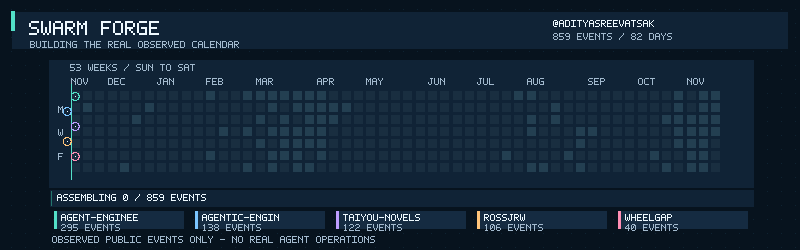
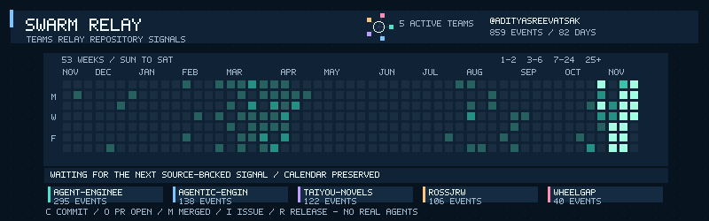
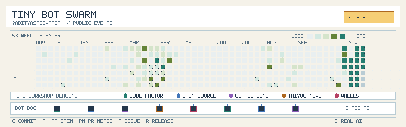
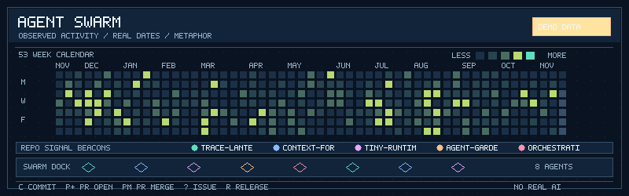
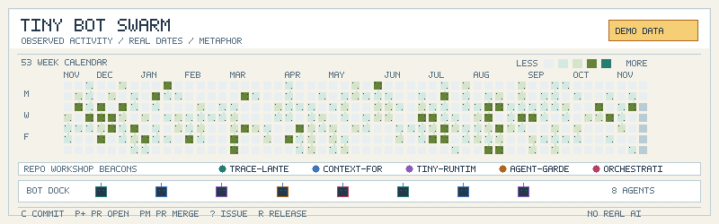

# Agent Swarm

Four original **visual metaphors** using a recognisable, source-backed **53-week GitHub-style activity calendar**. The new designs correct a problem with the earlier prototype: agents now have clearly defined outcomes, rather than appearing to attack individual contributions. All animations are deterministic visualisations, **not agents performing GitHub actions**. There are no LLM calls, external rendering services, paid APIs or GitHub writes.

## New account-specific concepts

### 1. Swarm Forge (recommended)

Five colour-coded builder teams **assemble the entire observed contribution chart from left to right**. Each week reveals its genuine recorded activity cells, the progress bar counts source-backed events, and the completed heatmap remains illuminated. The 14-second loop then restarts the assembly. **No day is removed and no contribution is fabricated.**

[Light GIF](exports/account/forge-light.gif) · [Dark still](exports/account/forge-dark-still.svg) · [Animated SVG](exports/account/forge-dark.svg)

### 2. Swarm Relay (alternative)

The full heatmap is present throughout. Five specialised repository teams send identifiable coloured signals from their hubs to **real recorded event dates in those repositories**. Traces are visible only while a signal is travelling, not as permanent random lines. A maximum of five actual days per team are selected for legibility; the calendar itself still represents **every collected in-window event**.

[Light GIF](exports/account/relay-light.gif) · [Dark still](exports/account/relay-dark-still.svg) · [Animated SVG](exports/account/relay-dark.svg)

**Compare in the browser:** Run `node concepts/agent-swarm/serve.mjs` and open `http://127.0.0.1:8000/`. Choose **Swarm Forge**, **Swarm Relay**, **Original geometric** or **Mini robots**. Change themes, pause, replay, scrub and inspect source-recorded days. The initial design is Swarm Forge. In reduced-motion environments the preview opens paused.

**Recorded-data boundaries:** The account snapshot on 18 November 2026 contains **859 observed public events across 82 recorded days and 42 represented repositories**. This is **not** GitHub's authoritative contribution graph and does not prove inactivity on empty dates. Only the five leading repositories receive named team hubs; no other recorded activity is omitted from the heatmap. The animation uses symbolic builders, not operational AI agents. The snapshot does **not** auto-refresh.

## Earlier designs retained

| Earlier geometric design | Earlier miniature robots |
| --- | --- |
| Couriers and builders travel to up to ten recorded event cells. These helpers can appear to remove or damage contributions, which is the reason for the redesign. | Playful robot helpers use the same ten-event schedule and calendar, retained for direct comparison rather than promoted as the main animation. |

[Geometric GIF](exports/account/geometric-dark.gif) · [Robot GIF](exports/account/robots-light.gif)

All separate sample data is labelled **synthetic demo**.

## Your account: @AdityaSreevatsaK

These animations are built from **859 verified public activity records** associated with @AdityaSreevatsaK, captured on **18 November 2026**: **327 PR openings, 259 PR merges, 114 opened issues and 159 authored commits**. The heatmap contains **82 observed dates**. This is a historical snapshot, not an automatically live feed. All records correspond to your public GitHub account. The earlier geometric and miniature robot designs animate ten selected events; the new Forge and Relay designs use the whole source-backed calendar and repository-specific routes respectively. No fictional events appear in the account-specific designs.

### Geometric Agent Swarm (your account)

### Miniature Robot Swarm (your account)

[Geometric still](exports/account/geometric-dark-still.svg) · [Robot still](exports/account/robots-light-still.svg)

**Coverage:** This is a calendar of **observed public events**, not GitHub's authoritative contribution-heatmap totals. GitHub may omit private activity, commits on other people's branches, and other contribution types from these collected sources. A blank square means no matching *collected* public event, not inactivity. Each contribution/task shown is backed by a GitHub URL in [the committed account snapshot](data/adityasreevatsak-public.json).

To inspect your account in the browser, run the server and open **http://127.0.0.1:8000/**. The account view is now the default. For the separate ten-event fixture use **http://127.0.0.1:8000/?source=demo**.

## Separate synthetic examples

The canonical ten-event fixture and the fictional 327-event showcase are retained **only for tests and design comparison**, clearly labelled as demonstration data.

**Synthetic geometric fixture**

**Synthetic robot fixture**

## Calendar interpretation

The 53-week, seven-day grid is **date-accurate for events present in the normalised input snapshot**. It is **not** GitHub's complete contributions graph. Intensity represents the number of **distinct recorded source events** per day, not a verified GitHub contribution total. Blank cells mean *no events in the provided snapshot*, **not** zero contributions. The calendar covers all 859 public records. Forge constructs all source-observed dates, while Relay animates up to five source-backed dates per each of the five busiest represented repositories. The earlier two designs still animate ten chronologically sampled events. The 14-second replay remains a visual metaphor.

## A richer, explicitly fictional visual showcase

The separate testing fixture remains the shared, ten-event synthetic demonstration dataset. For design evaluation, there is a separate **synthetic showcase** with 327 deterministically generated demonstration events across 187 days. It is visibly labelled **SYNTHETIC SHOWCASE**, and **does not represent your actual GitHub contribution history**. Its higher activity density makes the swarm choreography easier to judge.

**Geometric showcase:**

**Miniature-robot showcase:**

[See the dedicated showcase gallery](showcase.html). Both designs use exactly the same simulated source events and source-backed task mapping. Account-specific assets are generated from a checked-in public snapshot. The synthetic gallery is deliberately separate.

## Refresh your public account snapshot

To update the dated real-data artwork from public GitHub only (Node.js 20+, no packages):

~~~powershell
node concepts/agent-swarm/refresh-account.mjs
node concepts/agent-swarm/build.mjs --account
node concepts/agent-swarm/build.mjs --account --verify
~~~

The collector uses GitHub's public REST endpoints for PRs, issues and default-branch commits. The checked-in snapshot is a date-stamped public capture; original URLs accompany each event. The initial commit capture was capped at the latest 40 authored commits per owned public default branch, while future refreshes use paginated results. An optional read-only `GITHUB_TOKEN` environment variable helps with GitHub rate limits, but no credentials are written to files or required for offline tests. The collector refuses partial API results and writes the updated JSON only when collection succeeds. It **never** requests private repositories or changes GitHub data.

Commit the refreshed JSON and generated account exports to the feature branch after reviewing them. The artwork remains a dated public-activity snapshot, not the complete official GitHub contributions grid.

## Windows: start to finish

**Beforehand:** install [Node.js 20 or later](https://nodejs.org/) and clone or download this repository. No tokens or extra packages are needed.

1. Open **PowerShell** in the GitHub-Activity-Studio repository.
2. Generate preview assets and GIF animations:

~~~powershell
node concepts/agent-swarm/build.mjs
node concepts/agent-swarm/build.mjs --verify
node concepts/agent-swarm/build.mjs --account
node concepts/agent-swarm/build.mjs --account --verify
~~~

3. Start the private local preview server (the build also regenerates the optional synthetic showcase assets):

~~~powershell
node concepts/agent-swarm/serve.mjs
~~~

4. Open **http://127.0.0.1:8000/** for your actual public account, **http://127.0.0.1:8000/?source=demo** for the tiny fixture, or **http://127.0.0.1:8000/showcase.html** for the richer fictional gallery. Switch design and theme, pause/replay, scrub the timeline, inspect date cells with the mouse or use the keyboard-accessible recorded-day selector. Press **Ctrl+C** to stop.
5. Run tests in another PowerShell window:

~~~powershell
node --test concepts/agent-swarm/tests/*.test.mjs
~~~

Both new modes are now included in every regular build and `--verify` invocation. All four new GIF variants loop for 14 seconds at 800 × 250, with animated SVGs and no-motion stills. To use a different, already-normalised public snapshot:

~~~powershell
node concepts/agent-swarm/build.mjs --input .\path\to\activity.json
~~~

You can specify --out for a custom export directory. The browser preview reads from this concept's default exports directory.

The `--verify` command checks all generated files byte-for-byte without changing them. It exits with an error if an asset is missing or stale. Run it after editing the renderer or the source fixture.

## Outputs

- `exports/account/{forge,relay}-{dark,light}.gif`: recommended new account-specific animations.
- `exports/account/{forge,relay}-{dark,light}.svg` and `-still.svg`: animated and accessible still alternatives.
- `exports/account/story.json` and `exports/story.json`: deterministic Forge/Relay source-derived calendar and repository signal schedule.
- `exports/{forge,relay}-{dark,light}.*`: clearly labelled synthetic demonstration media.

- exports/account/{geometric,robots}-{dark,light}.gif: your public GitHub account activity.
- exports/{geometric,robots}-{dark,light}.gif: four self-contained looping 14-second GIFs for GitHub READMEs.
- exports/geometric-dark.svg, geometric-light.svg, robots-dark.svg and robots-light.svg: detailed 14-second animated SVGs.
- exports/{geometric,robots}-{dark,light}-still.svg: four matching static, accessible alternatives.
- exports/scene.json: the precise input-derived event choreography. The browser uses this for its phase inspector.

Sample markdown for your public account (only use after reviewing the design):

~~~markdown

~~~

GIF is supported as an image format in GitHub READMEs. Animated SVGs may behave differently when served via GitHub's image proxy. **Actual rendered GitHub README verification has not yet been performed.** Neither design has been installed on any profile.

## Trustworthy mapping

Each observed GitHub event corresponds to **one** symbolic task, not one task per commit. The event timestamp selects a calendar cell; its repository becomes a secondary beacon. The kind determines a separate glyph: commit (C), PR opened (P+), PR merged (PM), issue opened (?), release (R). Its count appears explicitly as source-backed **units within the packet**, never disguised as commits. Each task pairs a **courier** that carries the symbolic event packet with a **builder** that processes it at the recorded-day cell. Both return to the dock. State transitions are queued → assigned → travelling → working → complete → delivered. The entire sequence is a metaphor; the original events were not made by AI agents, and its compressed timeline does not represent actual elapsed time.

The calendar covers **53 weeks** of observed events, while at most **five** recently active repository beacons and **ten chronologically sampled** event packets are animated. Clipping and out-of-window events are disclosed. Other repository histories are not inferred or invented. Source event IDs are deduplicated, and names are escaped. Empty data, one repository, missing optional metadata, bursty load, long names, invalid input and stale snapshots are handled. A 30-day stale warning is relative to the snapshot's generated timestamp. The account snapshot was collected from public GitHub searches and authored default-branch commits; it is a dated snapshot, not a live streaming connection.

## Technical notes and trade-offs

- **New narration:** The Forge progress marker and five builders follow a deterministic left-to-right sweep of the 53-week calendar; the completed state shows all observed dates. Relay signal destinations are selected only from dates where that specific repository has observed source events. The ongoing calendar is never erased in Relay.
- **Export parity:** New GIFs and SVGs use the same calendar dates and signal schedules; their visual drawing engines differ for legibility in raster and vector formats. The 14-second replay has 56 frames per GIF. For output reproducibility, use `build.mjs --verify`.

- Engine: deterministic offline Node.js ES modules using only the standard library. The separate optional `refresh-account.mjs` reads public GitHub API data; no paid providers, stored tokens or third-party fonts.
- Data: `data/adityasreevatsak-public.json` provides your dated account snapshot; `shared/fixtures/demo-activity.json` and `showcase.mjs` remain synthetic examples. The shared input contract is in docs/DATA_CONTRACT.md. Public refresh logic is contained entirely within Agent Swarm.
- Geometry: bright recorded-day cells, controlled routes, event halos, and repository beacons. Mini robots add face screens, antennae, charging docks, faint links between adjacent observed days, busy-day markers and paired approaches to activity cells. Both remain recognisable as calendar graphs.
- Exports: detailed SVG and simplified pixel GIF from the **same calendar and task schedule**, not pixel-identical files. A native LZW encoder avoids extra dependencies.
- Accessibility: descriptive SVG titles, descriptions, event-intensity legend, demo label, keyboard-operable recorded-date inspection, pause/replay controls and static fallbacks. Reduced-motion preferences initially pause the browser animation. GIFs have no automatic reduced-motion adaptation; use the matching still for each style/theme when necessary.
- The preview server binds to 127.0.0.1 and only serves two preview pages and generated media. It denies arbitrary source, .env files, malformed paths and symlink escapes. The inspector uses textContent, and export text is escaped.
- Tests cover validation, determinism, deduplication, state transitions, agent assignment conflicts, truncation, provenance, escaping, themes, rendering and GIF integrity.

**Before a profile release:** review readability at small sizes, inspect an actual GitHub README render, compare GIF sizes/contrast and decide which theme/design to keep. Leave master and all other concepts untouched.
