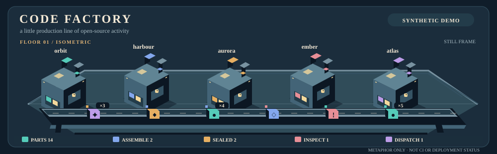

# Code Factory: contribution calendar × miniature factory

**Prototype. Synthetic demonstration activity only.** This concept is **not** installed on the owner's GitHub profile, and it is **not** an official GitHub contributions graph.

The **recognisable 53-column × 7-day GitHub-style calendar is now the centrepiece**. The factories are a second, charming layer: repository machines sit underneath the calendar, feeding a small conveyor with event-specific parcels. No fabricated events or production metrics.

## Rendered previews

### Isometric workshop, night shift



### Side-scrolling pixel factory, day shift


Also available: [isometric day](exports/isometric-light-still.svg) · [pixel night](exports/pixel-dark-still.svg).

Animated versions (optional): [isometric night](exports/isometric-dark.svg) · [isometric day](exports/isometric-light.svg) · [pixel night](exports/pixel-dark.svg) · [pixel day](exports/pixel-light.svg).

**For an actual GitHub README, use a still SVG first.** These stills are intentionally embedded above so that the design can be reviewed without animation. Animated-SVG playback through GitHub's image proxy is not yet verified.

## What the calendar and factory mean

- **Columns are weeks; rows are Sunday to Saturday**, using the final 53 calendar-week columns as at the snapshot's `generated_at` timestamp. The last week may be incomplete.
- **Green squares mark days with recorded events** from the input. Shade represents the total recorded **event units** for that day, *not necessarily GitHub contribution counts*.
- **Repositories become named machines.** The five busiest stations (by recorded units) are selected, with explicit overflow if necessary.
- **Events become parcels** on the lower conveyor: commits = parts (teal), PR opened = assembly (blue), PR merged = sealed (amber), issues opened = inspection (coral), releases = dispatch (purple). The visual metaphor does **not** suggest actual CI, builds, deployments or shipping.
- A source-backed event with `count: N` produces **one parcel marked ×N**, not N invented activity records. The graph deduplicates identical event IDs, rejects conflicting IDs and sorts chronologically.
- The 52-week window includes only dates at/before `generated_at`. Recorded events outside that window are disclosed. An empty square means no **recorded event in this snapshot**, **not** proven inactivity on GitHub.

The snapshot is deliberately **partial**. GitHub's official contributions heatmap uses more nuanced contribution rules, eligibility, privacy and source coverage. Do not claim this visual is an exact copy of that heatmap without a future shared, verified collector.

## Run locally on Windows

Requires **Node.js 20+**, no packages, no tokens, and no external network access after cloning. From PowerShell:

```powershell
git clone https://github.com/AdityaSreevatsaK/GitHub-Activity-Studio.git
cd GitHub-Activity-Studio
git switch concept/code-factory
node concepts/code-factory/calendar-factory.mjs
node --test concepts/code-factory/tests/test_calendar_factory.mjs
python -m unittest discover -s concepts/code-factory/tests -v
python -m http.server 8000
```

Open **http://localhost:8000/concepts/code-factory/preview.html**. Choose either layout, light/dark colour theme or still/animated motion. The preview starts in **still mode**, including on mobile.

To export from your own v1 normalised snapshot:

```powershell
node concepts/code-factory/calendar-factory.mjs "C:\path\to\snapshot.json" "C:\path\to\exports"
```

This regenerates the **eight** profile-sized standalone SVGs: two styles × two themes × animated/still. The original `factory.py` remains as a historical experiment; it **does not produce this calendar-first version**. Do not run it over the new exports.

## Engineering and design notes

- One deterministic source of truth: `calendar-factory.mjs`, with no third-party sprites, fonts, APIs or dependencies.
- All names and event tooltips are XML-escaped; unsupported kinds, malformed timestamps, invalid counts and conflicting duplicate IDs are rejected.
- Mobile renders scale the 1000 × 320 SVG without horizontal overflow. At narrow sizes, month and station labels become small; the HTML preview provides a larger view.
- SVGs contain accessible title/description text. Static versions have no motion; animated versions use CSS and SVG SMIL, with reduced-motion styling.
- The five-station limit and nine-parcel limit affect only the factory strip. The **calendar still reflects all valid records within the displayed date window**.
- This branch is a prototype. A future verified public-only GitHub collector should be shared between all concepts rather than improvised here.

**Remaining before release:** visually verify both variants in GitHub's rendered README at mobile width, run Windows-native test commands, and confirm the optional animated SVG behaviour in GitHub's image delivery. Keep this PR as **draft**; do not merge or modify the live profile.
