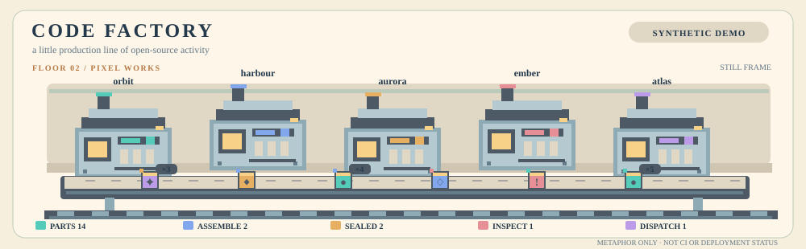

# Code Factory

### A living contribution calendar, not a factory pasted under a chart

**Synthetic demonstration.** The images below use `shared/fixtures/demo-activity.json`. They are **not** the owner's real GitHub contributions, and the counts are recorded **event units**, not official GitHub contributions totals.

The highlighted contribution **week** expands into a seven-day miniature production line directly below it. A day with no recorded activity stays idle. An active day displays only its actual repository and event-type machinery.

## Rendered designs (still images)

### 1. Isometric Foundry · Night shift


### 2. Pixel Works · Day shift



Also available: [Isometric daylight](exports/isometric-light-still.svg) · [Pixel night](exports/pixel-dark-still.svg) · [Optional animated isometric](exports/isometric-dark.svg) · [Optional animated pixel](exports/pixel-light.svg).

**[Open the browser preview](preview.html)** for theme switching and the selectable contribution weeks. On GitHub, this URL shows the source file: run the local server below to interact with the preview. GitHub README images cannot run JavaScript, so the committed stills show a deterministic **latest active week**.

## Proof the factory and calendar match

In the shared fixture, the default selected week is **8–14 November 2026**:

| Date | Calendar activity | Factory action |
| --- | --- | --- |
| Monday 9 November | 4 recorded commit units | **harbour** part forge, labelled ×4 |
| Friday 13 November | 1 PR-opened record | **ember** assembly arm, labelled ×1 |
| Other days | No recorded records | Idle machinery, no event parcels |

Change the selected week in the browser. The highlighted column, seven day lanes, machine names, event types, units and the ledger all update together. Choosing a week without recorded events produces seven idle lanes, never decorative fake production.

Five production metaphors are deliberately distinct:

- `commit` → **parts forge** (teal)
- `pr_opened` → **assembly arm** (blue)
- `pr_merged` → **sealing press** (amber), *not a deployment*
- `issue_opened` → **inspection lens** (coral), *not necessarily a bug*
- `release` → **dispatch crane** (violet)

Each source event produces one labelled machine and preserves its original `count` as **×N**. A day with more than two events displays two machines and a truthful `+N more recorded events` marker. All recorded activity within the calendar's date window still contributes to the entire heatmap. The highlight and the factory are driven by exactly the same week model.

## Windows PowerShell quick start

Requires **Node.js 20+** and Python 3 for the optional local web server. The renderer itself uses only built-in Node modules: **no npm install, GitHub token, paid API or live network access**.

```powershell
git clone https://github.com/AdityaSreevatsaK/GitHub-Activity-Studio.git
cd GitHub-Activity-Studio
git switch concept/code-factory

# Regenerate all eight SVGs from the common synthetic fixture
node concepts/code-factory/calendar-factory.mjs

# Run the contract, week-mapping and SVG tests
node --test concepts/code-factory/tests/test_calendar_factory.mjs

# Explore and click any of the 53 calendar-week columns
python -m http.server 8000
```

Open **http://localhost:8000/concepts/code-factory/preview.html**.

To render another **normalised v1 snapshot** and choose a specific calendar-week column (0–52):

```powershell
node concepts/code-factory/calendar-factory.mjs "C:\path\to\snapshot.json" "C:\path\to\output" --week-index 51
```

Without `--week-index`, the exporter automatically picks the most recent week with recorded activity. If none exist, it displays the current calendar week with idle lanes.

The old `factory.py` is retained for historical comparison. **It is not the source of these updated exports.** Running it over `exports/` overwrites the new design, so use the Node exporter instead.

## How the data is handled

- The normalised snapshot follows [the shared data contract](../../docs/DATA_CONTRACT.md). No concept-specific GitHub collector has been added.
- Calendar columns are **53 Sunday-start weeks**, covering approximately the previous 52 weeks plus the current incomplete week. Days after `generated_at` are not treated as zero contributions, and events after the snapshot's UTC timestamp are excluded.
- Event IDs are deduplicated, conflicts rejected, repository ownership preserved using `full_name`, and timestamps handled as UTC. Text is escaped before becoming SVG attributes or labels.
- Colour intensity reflects *recorded event units* across the day. Because the shared fixture is sparse, an empty calendar cell means **no input record**, not proof that no contributions occurred.
- A selected day has one miniature machine per visible event; to stay readable at 1200 × 430 px, only the first **two event records per day** are drawn, with overflow disclosed.
- All artwork uses original procedural SVG geometry, with different isometric and pixel-art drawings; no external imagery, fonts or third-party sprites.

## Accessibility and GitHub behaviour

The browser preview provides an accessible week selector, previous/next buttons, event ledger, static default and optional motion. Each SVG contains a title, description and event-specific machine titles. Browser reduced-motion preferences are respected, and a static SVG can always be used instead.

The **README embeds still SVGs**, so the design can be judged without relying on GitHub SVG animation support. CSS/SMIL animation in GitHub's image proxy is not claimed as verified. Labels will be smaller on mobile because the complete 53-week chart shares a single wide image.

### Verification status

- **13 targeted regression scenarios passed in an isolated JavaScript validation harness**, including source-week mapping, fake-activity prevention, empty weeks, overflow, unsafe input and four theme/layout combinations.
- Native `node --test`, Windows PowerShell execution, browser interaction and GitHub's image proxy **have not yet been independently verified** in their actual runtimes.
- The pull request remains draft. **No changes to `master` or the owner's profile.**

The next review should focus on visual legibility, verifying the embedded still images on GitHub, and only then considering shared real-data integration with the other concepts.
