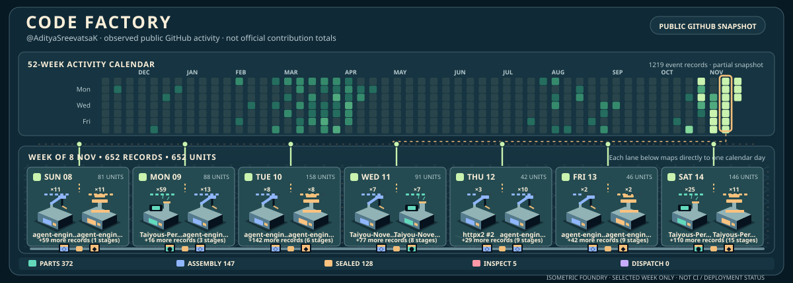
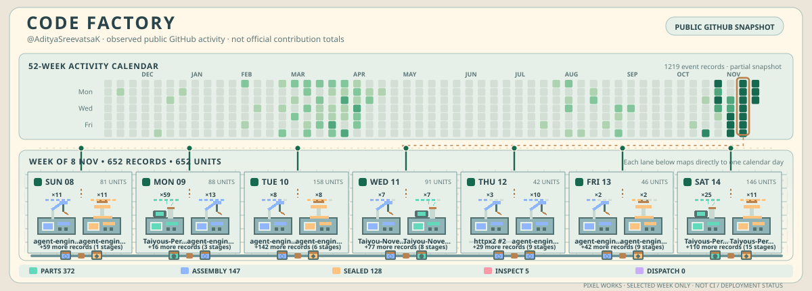
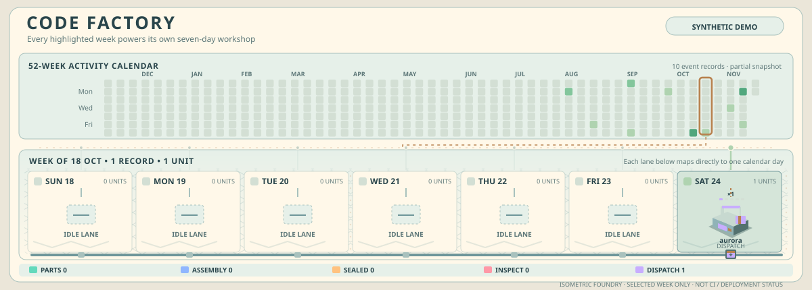
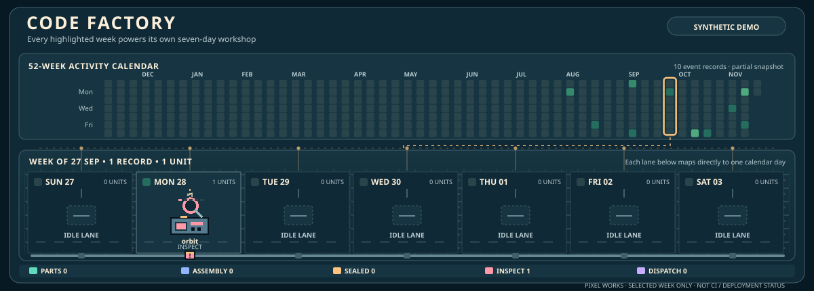

# Code Factory · @AdityaSreevatsaK

### Your public GitHub activity, turned into a miniature factory

**REAL PUBLIC ACTIVITY SNAPSHOT · 17 November 2026, 08:01 UTC.** These images were generated from observed public GitHub PRs, issues, merges and commits associated with [@AdityaSreevatsaK](https://github.com/AdityaSreevatsaK), **not synthetic demonstration records**.

## Your account-specific factory

### Isometric Foundry · Dark



### Pixel Works · Light



Other account themes: [Isometric light](exports/account-isometric-light-still.svg) · [Pixel dark](exports/account-pixel-dark-still.svg).

The selected full week is **8–14 November 2026**, with **652 observed public event records** distributed across all seven days. The highlighted column drives the named repository machines and source-backed parcels below it.

| Public records in this snapshot | Count |
| --- | ---: |
| Authored commits found on scanned public owned default branches | 499 |
| Pull requests opened in public repositories | 332 |
| Those PRs merged within the observed period | 273 |
| Issues opened in public repositories | 115 |
| **Total observed event/stage records** | **1,219** |

**Important scope:** this is **not GitHub's official contribution calendar**. Counts are observable **event/stage records**, not the number GitHub credits as contributions. A PR opening and its later merge are shown as separate factory events. The commit scan covers **30 public owned repositories on their default branches** and may omit other contributions, unmerged feature-branch commits, and activity outside the indexed search results. **No private repository data is included.**

Raw, auditable source data: [public account snapshot](fixtures/adityasreevatsak-public-activity.json). Source: GitHub REST public PR/issue search and public-repository commit listings, captured at the timestamp above. The data is a **point-in-time export**, not a live updating graph.

## How the factory works

The highlighted **week** expands into a seven-day miniature production line directly below the chart. Each active calendar day powers a matching machine and parcel, with a source-backed label, while inactive days stay idle.

The seven colour-coded signal links below the calendar match the individual days of the selected week: stronger recorded activity produces a brighter connection, while empty days remain muted. Static exports show machinery **and** parcels without requiring animation.

## Synthetic demonstration (retained for tests)

The previews below deliberately use `shared/fixtures/demo-activity.json`, **not the account snapshot**. They remain available so that changes to the renderer can be regression-tested without querying GitHub.

The highlighted contribution **week** expands into a seven-day miniature production line directly below it. A day with no recorded activity stays idle. An active day displays only its actual repository and event-type machinery.

The **seven colour-coded signal links** below the calendar match the individual days of the selected week: stronger recorded activity produces a brighter connection, while empty days remain muted. Static exports include the matching machine **and parcel** without requiring animation.

## Synthetic demo designs (still images)

### 1. Isometric Foundry · Night shift


### 2. Pixel Works · Day shift


Also available: [Isometric daylight](exports/isometric-light-still.svg) · [Pixel night](exports/pixel-dark-still.svg) · [Optional animated isometric](exports/isometric-dark.svg) · [Optional animated pixel](exports/pixel-light.svg).

### Different weeks, different machinery

These are two **additional, source-backed exports** using other active weeks of the same fixture. They make it possible to inspect the actual differences between production stages without needing JavaScript.

| Release week, 18–24 October | Inspection week, 27 September–3 October |
| --- | --- |
|  |  |

**These are separate historical weeks, not extra activity added to the demonstration.**

**[Open the browser preview](preview.html)** to switch between the **account snapshot and synthetic demo**, choose a calendar week, change the theme or layout and inspect actual day-to-machine mappings. On GitHub, this URL shows the source file: run the local server below to interact with the preview. GitHub README images cannot run JavaScript, so the committed stills show a deterministic **latest active week**.

## Proof the factory and calendar match

In the shared fixture, the default selected week is **8–14 November 2026**:

| Date | Calendar activity | Factory action |
| --- | --- | --- |
| Monday 9 November | 4 recorded commit units | **harbour** part forge, labelled ×4 |
| Friday 13 November | 1 PR-opened record | **ember** assembly arm, labelled ×1 |
| Other days | No recorded records | Idle machinery, no event parcels |

Change the selected week in the browser. The highlighted column, seven day lanes, machine names, event types, units and the ledger all update together. Choosing a week without recorded events produces seven idle lanes, never decorative fake production.

Five production metaphors are deliberately distinct:

- `commit` → **parts forge** (teal)
- `pr_opened` → **assembly arm** (blue)
- `pr_merged` → **sealing press** (amber), *not a deployment*
- `issue_opened` → **inspection lens** (coral), *not necessarily a bug*
- `release` → **dispatch crane** (violet)

Each active repository and event stage creates **one machine and one matching parcel per day**, even in the static SVG used in GitHub's README. Repeated records with the same repository and stage share that machine: record count and total recorded units remain visible, and ×N represents those units. Five small machine lights scale with the recorded units. A day with more than two distinct machine stages displays two and a truthful overflow marker counting the hidden records and stages. The entire calendar still reflects **all eligible records**, not only the two visible machines. The week highlight, daily machines and browser ledger use the same source model.

## Windows PowerShell quick start

Requires **Node.js 20+** and Python 3 for the optional local web server. The renderer itself uses only built-in Node modules: **no npm install, GitHub token, paid API or live network access**.

```powershell
git clone https://github.com/AdityaSreevatsaK/GitHub-Activity-Studio.git
cd GitHub-Activity-Studio
git switch concept/code-factory

# Regenerate all eight SVGs from the common synthetic fixture
node concepts/code-factory/calendar-factory.mjs

# Re-run both native test suites with one command
.\concepts\code-factory\verify.ps1

# Or run each separately
node --test concepts/code-factory/tests/test_calendar_factory.mjs
python -m unittest discover -s concepts/code-factory/tests -v

# Explore and click any of the 53 calendar-week columns
python -m http.server 8000
```

Open **http://localhost:8000/concepts/code-factory/preview.html**.

**Optional:** `.\concepts\code-factory\verify.ps1 -Regenerate` refreshes all ten committed SVGs before running both suites. The two historical sample stills are source-backed committed gallery assets.

To render another **normalised v1 snapshot** and choose a specific calendar-week column (0–52):

```powershell
node concepts/code-factory/calendar-factory.mjs "C:\path\to\snapshot.json" "C:\path\to\output" --week-index 51
```

Without `--week-index`, the exporter automatically picks the most recent week with recorded activity. If none exist, it displays the current calendar week with idle lanes.

The old `factory.py` remains for historical comparison. **It is not the source of these exports.** Its default output now goes to `exports-legacy/` to protect the calendar assets; explicitly targeting `exports/` with the old exporter would still overwrite them. Use the Node exporter for this design.

## How the data is handled

- The normalised snapshot follows [the shared data contract](../../docs/DATA_CONTRACT.md). No concept-specific GitHub collector has been added.
- Calendar columns are **53 Sunday-start weeks**, covering approximately the previous 52 weeks plus the current incomplete week. Days after `generated_at` are not treated as zero contributions, and events after the snapshot's UTC timestamp are excluded.
- Event IDs are deduplicated, conflicts rejected, repository ownership preserved using `full_name`, and timestamps handled as UTC, including optional millisecond precision. Text is escaped before becoming SVG attributes or labels.
- Colour intensity reflects *recorded event units* across the day. Because the shared fixture is sparse, an empty calendar cell means **no input record**, not proof that no contributions occurred.
- A selected day has one miniature machine per visible event; to stay readable at 1200 × 430 px, only the first **two distinct repository-stage machines per day** are drawn, with total hidden records and stages disclosed.
- All artwork uses original procedural SVG geometry, with different isometric and pixel-art drawings; no external imagery, fonts or third-party sprites.

## Accessibility and GitHub behaviour

The browser preview defaults to the public account dataset and provides a demo switch, an accessible week selector, previous/next buttons, keyboard arrow/Home/End navigation on the highlighted calendar column, a bounded source-backed event ledger, a static default, an optional detail zoom for mobile and optional motion. Each SVG contains a title, description and event-specific machine titles. Browser reduced-motion preferences are respected, and a static SVG can always be used instead.

The **README embeds still SVGs**, so the design can be judged without relying on GitHub SVG animation support. [GitHub's documentation](https://docs.github.com/en/repositories/working-with-files/using-files/working-with-non-code-files) says inline SVG animation and scripting are unsupported in its file viewer. Treat optional animated SVGs as **local-browser previews**, not GitHub profile deliverables. Use the committed static SVGs in a README; a separately rendered GIF would be required for reliable animated playback. Labels will be smaller on mobile because the complete 53-week chart shares a single wide image.

### Verification status

- **27 targeted regression scenarios passed in an isolated JavaScript validation harness**, including source-week mapping, fake-activity prevention, empty weeks, overflow, unsafe input and four theme/layout combinations.
- Native `node --test`, the PowerShell verification script, browser interaction and GitHub's image proxy **have not yet been independently verified** in their actual runtimes. All ten SVGs were previously matched byte-for-byte with the renderer and passed structural checks; the current revisions also have deterministic JavaScript coverage. The verifier now checks all ten committed SVGs against freshly regenerated copies without changing the repository. It normalises Windows CRLF/LF line endings only, preventing false failures on Windows Git checkouts. A new loop-boundary regression ensures optional moving parcels fade rather than jumping; still exports include the same event parcels without motion.
- The pull request remains draft. **No changes to `master` or the owner's profile.**
- The two artwork styles use different factory floors and machinery, with crisp-edged geometry for pixel art; both retain the same exact calendar data.

The account-specific previews are now in this README. Next verification priorities are actual browser/mobile rendering and improving the shared, reusable account-data refresh pipeline. No live profile changes are made.
