# GitHub Constellation · A calendar written in stars

**Prototype on `concept/constellation` only. No changes to the GitHub profile or `master`.**

> **Synthetic demonstration, NOT the owner's GitHub contribution history.** This 53-week chart shows only **events present in the shared fixture**. Empty squares mean *no event recorded by this input*, NOT proof of zero GitHub contributions.

## The constellation, now with a signal lens

This is **not** a conventional statistics card or a disconnected astronomy illustration. The upper sky retains GitHub’s actual **53 × 7 weekday grid**. The lower **Signal Lens** magnifies dated repository activity into clearly visible, colour-coded, connected star paths, so a sparse source snapshot still tells a story.

- **Data-driven nebula:** the coloured atmosphere centres on the actual recorded dates; ambient dust is decorative, not contribution points.
- **Repository orbits:** trails connect observations of the **same repository**, in both the calendar and a magnified recent-activity panel. No invented relationships.
- **Two real treatments:** **Star chart** uses a GitHub-like square heatmap; **Comet trails** has a diamond-marked sky, smoother lines and distinct themes.
- **Interactive exploration:** switch layouts/themes, compare, pause, hide trails, spotlight one repository or inspect active days and zoomed signals by pointer or keyboard.
- **Sensible bounds:** at most 150 distinct events replay as pulses; the lens groups activity by repository/date and shows at most the latest 80 repository-days. Any truncation is labelled.

All generated visuals are **1200 × 425**, self-contained and responsive. They work offline with Python 3.11+ and the unmodified shared fixture, without credentials or paid services.

## See the design rendered on GitHub

### 1. Star chart | Night sky

[](assets/calendar-atlas-night-animated.svg)

[View animated SVG](assets/calendar-atlas-night-animated.svg) · [Still](assets/calendar-atlas-night-still.svg) · [Light paper version](assets/calendar-atlas-paper-still.svg)

### 2. Comet trails | Paper chart

[](assets/calendar-trails-paper-animated.svg)

[View animated SVG](assets/calendar-trails-paper-animated.svg) · [Still](assets/calendar-trails-paper-still.svg) · [Dark version](assets/calendar-trails-night-still.svg)

<details><summary><b>See the other two theme combinations</b></summary>

#### Star chart | Paper chart


#### Comet trails | Night sky


</details>

These are **actual SVG exports committed on this branch**, not illustrations of a planned implementation. GitHub can display the still images in this README; SVG animation inside GitHub's image proxy remains unverified. For independent playback, open the animated SVG directly (choose **Raw** in the GitHub file viewer). HTML and JavaScript cannot run inside GitHub Markdown.

## Meaningful, chart-first encoding

- **Exactly 53 columns × 7 rows** represent Sunday-first UTC calendar weeks, fixed relative to `generated_at`. The current week's future dates are muted.
- **Square brightness** shows source-backed, per-day *activity units*, across commits, opened/merged PRs, opened issues and releases. These are **not equivalent to GitHub's official contribution totals**.
- **A tiny repository-coloured star** identifies the leading recorded repository on an active day; the browser inspector reveals every repository and event kind if multiple occur on the same date.
- **Curved trails** connect consecutive *dated events within one repository*. This never asserts collaboration between repositories. The magnified lens groups events on the same repository/day and uses factual calendar spacing, not new data.
- **Pulses** replay at most 150 source events over a gentle 16-second loop. Motionless static SVGs and reduced-motion support are provided.
- **No artificial green squares**: the fixture contains only 10 dated events, so the historical portion of this demo appears sparse by design.

Two variants remain recognisable as GitHub contribution charts: **Star chart** retains square heatmap cells, while **Comet trails** places a subtle diamond-star lattice within the identical calendar geometry. Both support dark night-sky and light paper-cartography themes. All artwork is generated locally.

## Windows PowerShell

From the **GitHub-Activity-Studio** repository root, with Python 3.11+ installed:

```powershell
# Generate 8 exports, with no API key, installation or network required
py -3 concepts/constellation/calendar_sky.py

# Run both the new and original prototype test suites
py -3 -m unittest discover -s concepts/constellation/tests -v

# Serve the interactive browser preview
py -3 -m http.server 8000
```

Open <http://localhost:8000/concepts/constellation/preview.html>. Try **Star chart / Comet trails**, **Night sky / Paper chart**, **Compare layouts**, **Hide trails**, **Repository spotlight**, **Pause animation**, and hover or Tab over a bright day or a signal-lens point. Press `Ctrl+C` to stop the server.

For a contract-v1 **public-only** JSON snapshot:

```powershell
py -3 concepts/constellation/calendar_sky.py --input "C:\path\to\public-activity.json" --out "concepts/constellation/assets"
```

A later shared collector could provide fuller public contribution coverage, with pagination, visibility, identity and rate-limit controls. The renderer does not claim to collect the whole GitHub graph, query private data or automatically update.

## Tested and known limitations

- Deterministic standard-library renderer; **12 new calendar-specific regression tests**, in addition to 10 original star-map tests.
- Tests exercise 53×7 cells, dates, UTC, deduplication, intensity, multi-repository days, factual trails, source-backed lens grouping, truncation, static vs animated exports, input validation, escaping and performance bounds.
- GitHub profile README animation itself is **not verified**. Static fallbacks are provided and linked above.
- This folder retains the earlier **repository star-map experiment** as `constellation.py` with its original `radial-*` and `clustered-*` SVGs for design comparison. **The calendar-first implementation is now the recommended concept**.
- All examples are synthetic and rely on the same unmodified `shared/fixtures/demo-activity.json`. No tokens, external fonts or paid APIs are required.