# GitHub Constellation: a year of contributions, written in stars

Three **implemented** GitHub contribution-calendar animations on the isolated [`concept/constellation`](https://github.com/AdityaSreevatsaK/GitHub-Activity-Studio/tree/concept/constellation/concepts/constellation) branch. Each preserves the **53-week × 7-day Sunday-first calendar**; each active star comes from an actual date in its input, not decorative filler. No profile installation or `master` changes.

> **SYNTHETIC STRESS-TEST PREVIEWS.** The six illustrations below use a *separate, deliberately synthetic* fixture containing **65 active dates and 69 events** to make streak mechanics visible. They **do not depict any real person's history**. The repository's unmodified shared demo contains **10 synthetic events on 10 isolated dates**, so that dataset truthfully produces **no comets**. Unlit cells indicate *not represented in the sample*, **not** a verified zero in GitHub's contributions graph. Counts are mixed **recorded activity units**, not official GitHub contributions.

## Three concepts, directly rendered on GitHub

Click any still for its self-contained animated SVG. The table contains **six separate actual exports**; use the full-width previews below for detail.

| | Comet Streaks | Celestial Cartographer | Starforge |
|:--|:--|:--|:--|
| **Night** | [](assets/stress/comet-night-animated.svg) | [](assets/stress/cartographer-night-animated.svg) | [](assets/stress/starforge-night-animated.svg) |
| **Paper** | [](assets/stress/comet-paper-animated.svg) | [](assets/stress/cartographer-paper-animated.svg) | [](assets/stress/starforge-paper-animated.svg) |

### A. Comet Streaks: the meaningful motion

[](assets/stress/comet-night-animated.svg)

**Stars = recorded active days. Brighter = more activity units. Comets = uninterrupted streaks.** A single isolated date stays a star. Missing dates break the run. A Saturday-to-Sunday run stays chronological, but the drawn trail wraps to the next column without a misleading diagonal through unrecorded cells.

[Animated night](assets/stress/comet-night-animated.svg) · [Animated paper](assets/stress/comet-paper-animated.svg) · [Shared ten-event static](assets/comet-night-still.svg)

### B. Celestial Cartographer: the editorial survey

[](assets/stress/cartographer-paper-animated.svg)

The small original observatory stays outside the lattice. A moving meridian sweeps **chronologically by week**, revealing only already recorded dates. The final still keeps every real date at exactly the same position.

[Animated night](assets/stress/cartographer-night-animated.svg) · [Animated paper](assets/stress/cartographer-paper-animated.svg) · [Shared ten-event static](assets/cartographer-paper-still.svg)

### C. Starforge: the stellar foundry

[](assets/stress/starforge-night-animated.svg)

A tiny foundry casts **one spark per recorded active date**, ending on its true cell and brightening the star as it arrives. Multiple source events on one day resolve into a single day-star. The spark's brightness depends on the **summed recorded activity units**, not a fictitious number of contributions.

[Animated night](assets/stress/starforge-night-animated.svg) · [Animated paper](assets/stress/starforge-paper-animated.svg) · [Shared ten-event static](assets/starforge-night-still.svg)

### Complete source-fixture exports

The branch now includes **all 24 generated SVGs**: 12 (six still, six animated) from the unchanged ten-event shared synthetic fixture, and 12 from the clearly labelled synthetic streak fixture. In the ten-event fixture, [Comet Streaks (night)](assets/comet-night-animated.svg) correctly contains **no travelling comet**, while [Cartographer (paper)](assets/cartographer-paper-animated.svg) and [Starforge (night)](assets/starforge-night-animated.svg) animate only the ten recorded days.

## Interactive browser comparison

Open [`preview.html`](preview.html) through a local HTTP server to switch between all three designs, night/paper, shared/stress datasets, **Compare all three**, and **Pause/Resume**. Focus or hover any illuminated calendar cell for its *date, source event kinds, repositories and activity units*. The comparison adapts to phones with an internally scrollable calendar rather than overflowing the page. Reduced-motion preferences are respected.

### Windows PowerShell: reproducible offline build

Requires **Node.js 20+** (no npm install and no third-party packages) and Python 3.11+ or another local static server for the browser preview. From the repository root:

```powershell
# Render the source-of-truth ten-event shared fixture, six animated + six still
node concepts/constellation/export.mjs

# Render an explicitly synthetic, longer streak sample, another 12 exports
node concepts/constellation/export.mjs --input concepts/constellation/fixtures/streak-demo.json --out concepts/constellation/assets/stress --label "SYNTHETIC STREAK STRESS TEST"

# Run all 28 zero-dependency JavaScript regression tests
node --test concepts/constellation/tests/test_engine.mjs concepts/constellation/tests/test_motion.mjs

# Existing Python prototype regression suite (unchanged)
py -3 -m unittest discover -s concepts/constellation/tests -p "test_*.py" -v

# Serve the interactive preview from the repository root
py -3 -m http.server 8000
```

Open <http://localhost:8000/concepts/constellation/preview.html>. The export CLI accepts `--input`, `--out` and `--label`. Identical snapshot + options produce byte-for-byte identical SVGs. No network, token, fonts or paid services are needed for generation or tests.

### Optional GitHub-native animated GIFs

For a reliable animated GitHub README image, use the [optional GIF exporter](export_gif.py) to generate native GIFs from the source-backed SVGs. This uses Pillow and Playwright only when generating GIFs, and is not needed for the normal zero-dependency SVG pipeline.

```powershell
py -3 -m pip install Pillow playwright
py -3 -m playwright install chromium
py -3 concepts/constellation/export_gif.py
py -3 concepts/constellation/export_gif.py --theme paper
py -3 concepts/constellation/tests/browser_smoke.py
```

GIFs are generated locally, not yet bundled into the branch. The committed still SVGs are reliable README fallbacks.

## Accuracy, accessibility and GitHub compatibility

- Both fixtures use shared **contract v1**. IDs are deduplicated, timestamps are strictly UTC, source URLs are restricted to HTTPS GitHub, dates are Sunday-first and the current week's future days are muted. `commit`, `pr_opened`, `pr_merged`, `issue_opened` and `release` remain separate kinds.
- Intensity thresholds for recorded activity **units**: **1, 2–3, 4–6, 7+**. Unlit means **no event in this input**. Mixed-kind unit totals must not be mistaken for official GitHub contribution counts.
- A 16-second motion cycle uses data-backed cell positions. Comets join consecutive dates only; Cartographer's weekly sweep reveals known active dates; Starforge replays one particle per active date, bounded to 95 particles for very large inputs without hiding cells.
- All exports are self-contained 1200 × 390 SVGs with accessible `<title>`, `<desc>`, inspectable source-backed links, no external assets or scripts, and truly static alternatives. The browser preview offers keyboard navigation and controls, horizontal scrolling on small screens and `prefers-reduced-motion`.
- **GitHub rendering limitation:** the six static showcase files are embedded as standard Markdown images and their relative links are present in this branch. **Animated SVG playback through GitHub's image proxy is not verified**; GitHub may rasterise or suppress SVG motion. Open the linked animated `.svg` directly in a compatible browser. The static versions are the reliable README fallback.
- This remains **an event-sample renderer**, not an official annual contribution collector. GitHub's GraphQL `contributionsCollection.contributionCalendar` is a separate future source contract and must not be conflated with these mixed-event counts.

## Verification

Locally verified: **28/28 Node regression tests**, SVG XML parsing, image rasterisation, and Chromium browser interactions at **1280 px and 390 px** (all choices, theme, compare, pause, keyboard focus, both fixtures, no document overflow). Browser smoke used an in-memory content server because outbound/local navigation was restricted in the test environment. **Live GitHub-hosted animation rendering has not been independently confirmed.**

Legacy experiments (`calendar_sky.py`, `constellation.py` and their earlier SVG assets/tests) remain in place for comparison, but they are **not** the three new implementations. The existing [draft PR #1](https://github.com/AdityaSreevatsaK/GitHub-Activity-Studio/pull/1) is for review only; do not merge or edit the owner's live profile without approval.
