# Developer World

**A GitHub-style contribution calendar that becomes a miniature, evolving world.** Both original worlds use the same 53-week × 7-day UTC calendar. The archipelago turns each recorded day into an island plot; the village turns it into a tiny street-side lot. A day always stays in its original column and weekday row.

> **SYNTHETIC DEMO.** All bundled examples use `shared/fixtures/demo-activity.json`, not the owner's contribution history. This is an **event-log calendar**, not an official complete GitHub contribution calendar.

## See both worlds

| The Isles of Code: overhead archipelago (primary) | The Little Buildtown: side-view village |
| --- | --- |
|  |  |
| [Daybreak](previews/archipelago-light.svg) · [Still SVG](previews/archipelago-still.svg) | [Moonlit](previews/village-dark.svg) |

### Growth snapshots

| Quiet calendar | First four recorded events | Entire synthetic fixture |
| --- | --- | --- |
|  |  |  |

SVG exports are self-contained and use no external resources. The static fallback disables motion. **The browser preview also exports real animated GIF89a files**, a more reliable choice for GitHub README animation than CSS animation inside SVG. GIF frames are rasterised locally from the same SVG renderer and event timeline, using the bundled original dependency-free encoder.

## What each piece means

- **53 columns × 7 rows:** chronological Sunday-to-Saturday weeks ending in the week of `generated_at` (UTC). The six unused future days of the current week are muted. Month names and weekday labels remain visible.
- **One tile = one UTC date.** Its colour and physical growth come from recorded source events on that date only. The same activity is shown in both layouts.
- **Daily activity stages:** 0 units = quiet tile; 1–2 = sandy islet / field; 3–5 = greenery / cottage; 6–9 = workshop / building; 10+ = banner / tower. All quantities are source event `count` units, **not** guessed GitHub contributions.
- **Event-kind details:** release = beacon; PR merged = bridge detail; PR opened = work sign; issue opened = notice; commits = plant growth. These are visual motifs, not additional records.
- **Repositories:** up to five alphabetical `full_name` identities receive numbered markers and legend entries. Markers anchor to each repository's highest-unit, non-conflicting recorded date within the displayed window, selected using all snapshot events. Markers appear on the grid only once their associated date has that repository's visible activity. Unmappable repositories stay in the legend without a made-up date.
- **Transparency:** dates with no supplied events mean **no recorded event in this snapshot**, not proven zero contributions. Events outside the calendar window, including dates after the snapshot, do not colour tiles and are counted in the footer. More than five repositories are disclosed as omitted.

The shared fixture has **five repositories, ten distinct events and 20 recorded event units on ten dates**. The calendar is intentionally sparse because the fixture is sparse. We never fill cells with invented events.

## Windows PowerShell

Requires Git, Node.js 18+ and any modern browser. No `npm install`, Python, tokens, API requests or paid services.

~~~powershell
git clone https://github.com/AdityaSreevatsaK/GitHub-Activity-Studio.git
cd GitHub-Activity-Studio
git switch concept/developer-world
node concepts/developer-world/server.cjs
~~~

Open **http://127.0.0.1:8787/**. Choose archipelago/village and dark/light, scrub the event timeline, click a day on the grid or use the accessible UTC date picker and recorded-day buttons, or upload your own normalised public-data JSON (locally, without sending it to a service). To export a **profile-ready animated GIF**, click **Download animated GIF** in the browser. It samples 8–16 timeline frames at 896 × 280 pixels with moving scenery and a 450 ms frame delay.

In another PowerShell window:

~~~powershell
node concepts/developer-world/export.cjs
node --test concepts/developer-world/tests/world.test.cjs concepts/developer-world/tests/gif.test.cjs
~~~

Exports appear in `concepts/developer-world/exports/`. To export one layout with custom data:

~~~powershell
node concepts/developer-world/export.cjs --input .\activity.json --layout archipelago --theme dark
~~~

Use `--progress 0` to see the quiet starting calendar, `--progress 4` to show four events, and `--still` for motion-free export.

## Contract, limits and compatibility

- Consumes the shared [v1 normalised event snapshot](../../docs/DATA_CONTRACT.md). Deduplicates event IDs and sorts by UTC timestamp then ID. It does not treat all types of events as commits.
- Validates source format and event counts; escapes SVG labels, supports long names and empty datasets, honours `prefers-reduced-motion`, and uses no external artwork.
- Deterministic for an identical snapshot and timeline step. The layout uses the same 53×7 date coordinates irrespective of activity, unlike a free-form world layout.
- Supports up to 500 repository records and 20,000 event records, but only five compact legend landmarks. Month labels and cell detail remain readable in the browser; the wide SVG naturally scales down on a mobile README.
- The optional HTML browser preview provides date inspection, the event slider and local GIF download. **HTML/JavaScript cannot be embedded in a GitHub README.** The downloaded GIF is a standard GIF89a animation and remains animated without CSS or JavaScript. SVG animation through GitHub's image proxy is not guaranteed. The GIF may move even for viewers requesting reduced motion, so provide the [static archipelago alternative](previews/archipelago-still.svg) alongside any GIF. Browser-based GIF conversion still needs cross-browser testing.
- Events with timestamps later than the snapshot timestamp are not visualised, even if on the same UTC day. Calendar dates use strict Gregorian UTC validation. Activity outside the displayed period is disclosed and excluded from calendar totals.
- A future collector would need to declare coverage, pagination, recency and access restrictions. This renderer does **not** claim complete GraphQL contribution-calendar coverage from a sparse REST event log.

## Trade-offs and review

The overhead archipelago is the preferred profile candidate because its islands preserve square calendar cells especially clearly. The village adds a second, distinctly architectural rendering without changing dates or counts. Small cells constrain the amount of sprite detail; dense or multi-repository days prioritise one visible landmark marker, with full event detail remaining in the SVG accessible labels and browser list.

**Preview and GitHub embedding behaviour still need human visual review.** The actual full Node suite and GitHub image-proxy integration have not been run in this execution environment; direct renderer and GIF-code behavioural checks were performed independently. Do not install this on the owner's profile or merge into `master` without approval.
