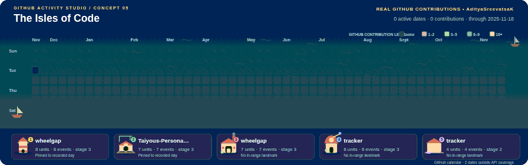

# Developer World

## Real account: AdityaSreevatsaK

**The primary goal is your real GitHub contribution calendar, not a demonstration.** These five previews are generated using GitHub's GraphQL contribution calendar for [AdityaSreevatsaK](https://github.com/AdityaSreevatsaK). The last 365 dates supplied by GitHub determine daily tile growth; recent public GitHub events add optional repository decorations, but never replace the contribution counts.

| Your archipelago | Your village |
|:---:|:---:|
|  |  |
| [Dark SVG](previews/real-archipelago-dark.svg) · [Light theme](previews/real-archipelago-light.svg) · [Still/reduced-motion SVG](previews/real-archipelago-still.svg) | [Dark theme](previews/real-village-dark.svg) |

**[Explore your real contribution data in the browser](http://127.0.0.1:8787/?sample=real)** after running the local preview. It loads `real-activity.json` by default, with synthetic datasets available as labelled alternatives.

The archipelago GIF reveals **actual historical contribution dates** in chronological order, with the original calendar values preserved. Motion-free SVGs are provided for accessibility. The [real-account GitHub Actions workflow](../../.github/workflows/developer-world-live.yml) collects the public GitHub-visible calendar using its built-in `GITHUB_TOKEN`, validates it, and writes five SVGs and a real browser-generated animated GIF directly into this concept branch. It does **not** modify your GitHub profile or other concepts. If those files are not yet present, the collector has not published them; the preview never substitutes synthetic values silently. Public event details are capped by the REST API and are not a full year's event ledger. GitHub GraphQL visibility may exclude private contributions unless they are visible to the workflow identity. Missing API dates are displayed as unknown, not as zero activity.

---

**A GitHub-style contribution calendar that becomes a miniature, evolving world.** Both original worlds use the same 53-week × 7-day UTC calendar. The archipelago turns each recorded day into an island plot; the village turns it into a tiny street-side lot. A day always stays in its original column and weekday row.

> **SYNTHETIC EXAMPLES BELOW.** The following sample galleries use `shared/fixtures/demo-activity.json`, not the owner's contribution history. This is an **event-log calendar**, not an official complete GitHub contribution calendar.

## See both worlds

**Showcase gallery:** an explicitly synthetic, richer **212-active-day** event log displays the worlds at a more representative visual density. It is **not** the owner's contribution history and is **not** the browser's default. The primary shared fixture stays unchanged.

| The Isles of Code: overhead archipelago (primary) | The Little Buildtown: side-view village |
| --- | --- |
|  |  |
| [Daybreak showcase](previews/archipelago-showcase-light.svg) · [Motion-free showcase](previews/archipelago-showcase-still.svg) | [Moonlit showcase](previews/village-showcase-dark.svg) |

**Original shared-fixture gallery:** [10-day archipelago](previews/archipelago-dark.svg) · [10-day village](previews/village-light.svg) · [Static shared-fixture SVG](previews/archipelago-still.svg). These sparse images remain the reproducibility baseline.

The showcase is generated deterministically with [`generate-showcase.cjs`](generate-showcase.cjs), stored separately as [`showcase-activity.json`](showcase-activity.json), and clearly labelled `source: "demo"`. It contains **243 synthetic events, 212 active dates and 1,050 event units**, all from the same five fictional repositories. Every event has an explicit invented-for-demo ID, UTC timestamp, type and count. It never fills unrecorded dates in actual user data.

### Growth snapshots

| Quiet calendar | First four recorded events | Entire synthetic fixture |
| --- | --- | --- |
|  |  |  |

SVG exports are self-contained and use no external resources. The static fallback disables motion. **The browser preview also exports real animated GIF89a files**, a more reliable choice for GitHub README animation than CSS animation inside SVG. GIF frames are rasterised locally from the same SVG renderer and event timeline, using the bundled original dependency-free encoder.

## What each piece means

- **53 columns × 7 rows:** chronological Sunday-to-Saturday weeks ending in the week of `generated_at` (UTC). Remaining days after the UTC snapshot date are muted. Month names and weekday labels remain visible.
- **One tile = one UTC date.** Its colour and physical growth come from recorded source events on that date only. The same activity is shown in both layouts.
- **Daily activity stages:** 0 units = quiet tile; 1–2 = sandy islet / field; 3–5 = greenery / cottage; 6–9 = workshop / building; 10+ = banner / tower. All quantities are source event `count` units, **not** guessed GitHub contributions.
- **Event-kind details:** release = beacon; PR merged = bridge detail; PR opened = work sign; issue opened = notice; commits = plant growth. These are visual motifs, not additional records.
- **Repositories:** up to five repositories with the most **recorded in-window event units** receive numbered landmarks and legend entries; ties use alphabetical `full_name` order. The selection is computed from the full snapshot, so timeline playback never reorders buildings. Markers anchor to each repository's highest-unit, non-conflicting recorded date within the displayed window, selected using all eligible in-window snapshot events. Markers appear on the grid only once their associated date has that repository's visible activity. Unmappable repositories stay in the legend without a made-up date.
- **Transparency:** dates with no supplied events mean **no recorded event in this snapshot**, not proven zero contributions. Events outside the calendar window, including dates after the snapshot, do not colour tiles and are counted in the footer. More than five repositories are disclosed as omitted.

The shared fixture has **five repositories, ten distinct events and 20 recorded event units on ten dates**. The calendar is intentionally sparse because the fixture is sparse. We never fill cells with invented events.

## Windows PowerShell

Requires Git, Node.js 18+ and any modern browser. No `npm install`, Python, tokens, API requests or paid services. You can optionally run `npm run preview`, `npm run export` and `npm test` directly from `concepts/developer-world/`.

~~~powershell
git clone https://github.com/AdityaSreevatsaK/GitHub-Activity-Studio.git
cd GitHub-Activity-Studio
git switch concept/developer-world
node concepts/developer-world/server.cjs
~~~

Open **http://127.0.0.1:8787/**. The server preserves safe, allowlisted URL options through its initial redirect, so you can go directly to **http://127.0.0.1:8787/?sample=showcase&layout=archipelago&theme=dark** or **http://127.0.0.1:8787/?sample=showcase&layout=village&theme=light**. The **real account calendar is the default**. You can also switch to the **unchanged shared synthetic fixture** or the **optional richer synthetic showcase**, then choose archipelago/village and dark/light, scrub the event timeline, click a day on the grid or use the accessible UTC date picker and recorded-day buttons, or upload your own normalised public-data JSON (locally, without sending it to a service). To export a **profile-ready animated GIF**, click **Download animated GIF** in the browser. It samples 8–16 timeline frames at 896 × 280 pixels with moving scenery and a 450 ms frame delay.

In another PowerShell window:

~~~powershell
node concepts/developer-world/export.cjs
npm --prefix concepts/developer-world test
~~~

Exports appear in `concepts/developer-world/exports/`. To export one layout with custom data:

~~~powershell
node concepts/developer-world/export.cjs --input .\activity.json --layout archipelago --theme dark
~~~

Use `--progress 0` to see the quiet starting calendar, `--progress 4` to show four events, and `--still` for motion-free export.

## Contract, limits and compatibility

- Consumes the shared [v1 normalised event snapshot](../../docs/DATA_CONTRACT.md). Deduplicates event IDs and sorts by the **true UTC chronology**, including timestamps with different fractional-second precision, then by ID. It does not treat all types of events as commits.
- Validates source format and event counts; escapes SVG labels, supports long names and empty datasets, honours `prefers-reduced-motion`, and uses no external artwork.
- Deterministic for an identical snapshot and timeline step. The layout uses the same 53×7 date coordinates irrespective of activity, unlike a free-form world layout.
- Supports up to 500 repository records and 20,000 event records, but only five compact legend landmarks. Month labels and cell detail remain readable in the browser; the wide SVG naturally scales down on a mobile README.
- The optional HTML browser preview provides date inspection, the event slider and local GIF download. **HTML/JavaScript cannot be embedded in a GitHub README.** The downloaded GIF is a standard GIF89a animation and remains animated without CSS or JavaScript. SVG animation through GitHub's image proxy is not guaranteed. The GIF may move even for viewers requesting reduced motion, so provide the [static archipelago alternative](previews/archipelago-still.svg) alongside any GIF. Browser-based GIF conversion still needs cross-browser testing.
- Events with timestamps later than the snapshot timestamp are not visualised, even if on the same UTC day. Calendar dates use strict Gregorian UTC validation. Activity outside the displayed period is disclosed and excluded from calendar totals.
- The concept-local [real account collector](collect-github.cjs) now uses the authoritative **GitHub GraphQL contributionsCollection** for each daily contribution count and GitHub REST **public events** only for recent named repository decorations (up to 300 API events). It records explicit coverage, validates the calendar and refuses to substitute inferred zeroes or synthetic history. The two sources are not added together.

## Trade-offs and review

The overhead archipelago is the preferred profile candidate because its islands preserve square calendar cells especially clearly. The village adds a second, distinctly architectural rendering without changing dates or counts. Small cells constrain the amount of sprite detail; dense or multi-repository days prioritise one visible landmark marker, with full event detail remaining in the SVG accessible labels and browser list.

**Verification:** [the isolated Developer World GitHub Actions workflow](../../.github/workflows/developer-world.yml) has passed the complete Node test suite and CLI export checks on **Windows and Linux**, and headless Chrome produced both rich showcase screenshots with the correct 371 date cells and 212 active dates. The screenshots are available as workflow artifacts. The browser GIF button also has an independent encoder test suite; the end-to-end browser GIF check is included in CI. **GitHub’s own proxied README animation remains unverified**, so the motion-free SVG is still the recommended fallback. Do not install this on the owner's profile or merge into `master` without approval.
