# Developer World

**Two miniature worlds, one transparent activity contract.** Five original repository landmarks grow from the recorded GitHub events in the shared snapshot. No tokens, third-party sprites, libraries or paid services.

## Visual previews

| Overhead archipelago (primary) | Side-view village |
| :--: | :--: |
|  |  |
| [Daybreak](previews/archipelago-light.svg) · [Still image](previews/archipelago-still.svg) | [Moonlit](previews/village-dark.svg) |

**These images use deliberately synthetic data. They do not show the owner's actual GitHub activity.**

The **archipelago** is the proposed profile layout: visually separate islands make repository boundaries clear. The **village** has a distinct skyline, roof shapes and environmental scenery, but more limited vertical room for tall buildings.

## Windows setup

Prerequisites: **Git**, **Node.js 18+** and a browser. No `npm install`, Python, cloud service or token required.

1. Open **PowerShell** and paste:

   ```powershell
   git clone https://github.com/AdityaSreevatsaK/GitHub-Activity-Studio.git
   cd GitHub-Activity-Studio
   git switch concept/developer-world
   node concepts/developer-world/server.cjs
   ```

2. Open **http://127.0.0.1:8787/**. Select a world, palette, activity timeline and animation setting. Upload your own normalised public-data JSON to replace the demo.
3. In a **second PowerShell window**, create all four animated exports and four matching still images:

   ```powershell
   node concepts/developer-world/export.cjs
   ```

4. Run the automated tests:

   ```powershell
   node --test concepts/developer-world/tests/world.test.cjs
   ```

Generated files appear under `concepts/developer-world/exports/`.

Custom export:

```powershell
node concepts/developer-world/export.cjs --input .\activity.json --layout archipelago --theme light
```

For more options: `node concepts/developer-world/export.cjs --help`.

## Progression based on recorded data

Input uses [the shared v1 JSON contract](../../docs/DATA_CONTRACT.md). Events are sorted by their UTC timestamp and then ID; duplicate IDs are counted once. A timeline step represents **one distinct recorded event**, while the world grows by the source event's positive `count`. Different activity kinds are **never all called commits**.

| Recorded units for a repository | Stage | Visual result |
| ---: | :---: | --- |
| 0 | 0 | Quiet home |
| 1–2 | 1 | Lit windows and lanterns |
| 3–5 | 2 | Garden paths and flowers |
| 6–9 | 3 | Upgraded roof |
| 10+ | 4 | Pennant at the roof |

Kind-specific decorations give events meaning independently of growth tiers: **3 commit units** plant a garden; **opened PRs** raise scaffolding; **merged PRs** add a boat (islands) or bridge decoration (village); **issues** put up noticeboards; **releases** create a beacon.

**See it develop:** set the browser timeline to **0**, then **4**, then **10** to see the demo progress. To test stage 4, provide a normalised source event with at least 10 recorded units for one repository. Growth never invents missing events or achievements.

## Scope and limits

- Only the **five alphabetically first** repositories, sorted by `full_name`, appear as miniature landmarks. Further repositories are explicitly reported, not silently misrepresented. Upper limits: 500 repositories and 20,000 input events.
- Positions and artwork are deterministic for the same repository set and event prefix. Adding or removing repositories can change the slots, but changing activity alone does not reposition them.
- All repository names in descriptions are escaped; displayed names longer than 18 characters are truncated in the wide SVG, with the full names retained in the browser's accessible list. The SVG includes a `title` and `desc`.
- Light and dark images are exported separately. SVG CSS animation works without JavaScript; `prefers-reduced-motion` disables animation. Still SVGs contain an explicit animation override and remain readable when CSS animation is blocked.
- No live collector is included, per the parallel-session agreement. `source: "github"` means that a trusted upstream collector supplied a *public* snapshot. Coverage is limited by that collector's API access, pagination, visibility and recency. There is **no claim** of a complete GitHub contributions graph.
- No private repository metadata, GitHub tokens, cloud APIs, API calls or paid services are used in the demo or tests. The optional browser file upload stays within the local browser.
- Mobile browsers scale the wide SVG down; the accompanying textual repository list remains readable. The fixed 16:5 composition favours a profile-sized landscape over dense metadata.

## GitHub README export

Proposed still-image embed, **not to be installed on the profile until approved**:

```markdown

```

**GitHub README rendering has not been independently verified.** GitHub's image proxy may restrict SVG animations; use the still SVG if animation is suppressed. The browser preview uses JavaScript and cannot be embedded inside GitHub README pages. An animated GIF was not added to keep the base toolchain dependency-free.

### Trade-offs and next improvements

The archipelago currently favours clarity over detailed roof silhouettes; the village prioritises atmospheric storytelling. High repository counts need filtering or paging in a later version. Before release: confirm the actual GitHub-rendered SVG behaviour, test mobile screenshots in several browsers, and evaluate a shared public GitHub collector. No changes have been made to the profile or `master`.

**Status: isolated concept prototype, pending draft PR review.**
