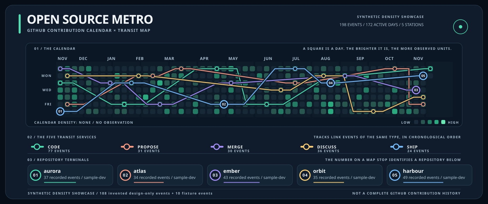
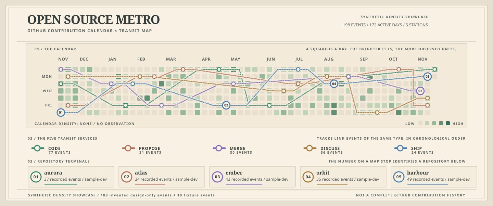
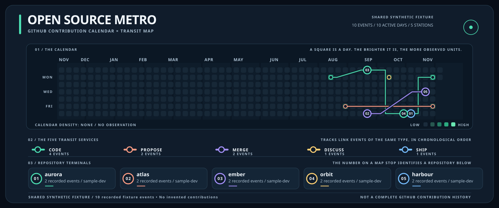
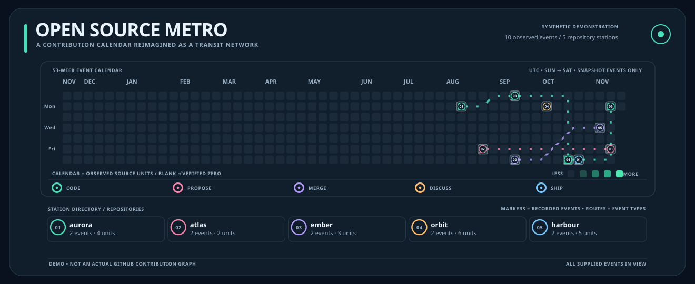
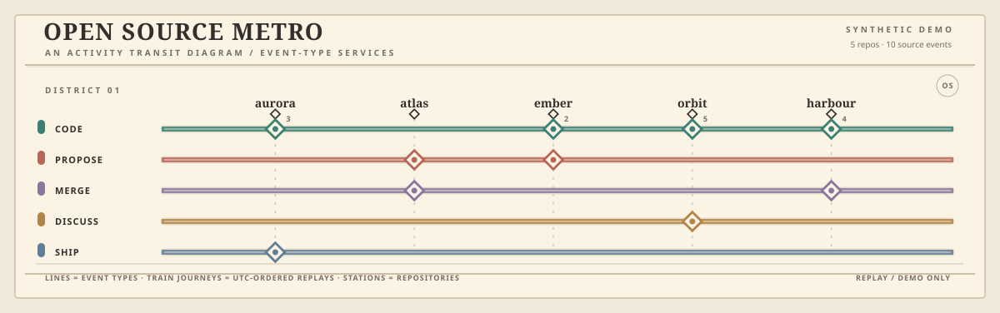
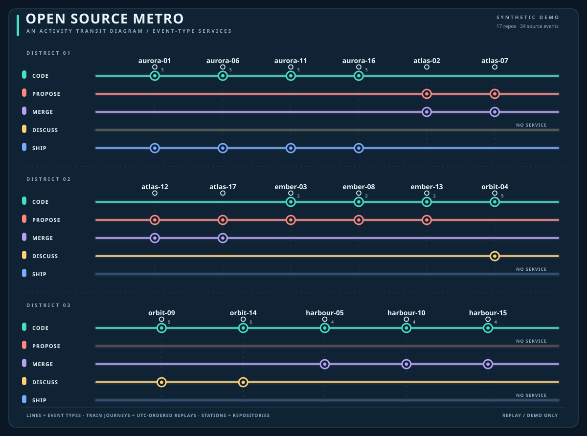

# Open Source Metro

## Metro Atlas | Visual redesign

**A contribution calendar that also behaves like a metro map.** The 53-week × 7-day grid remains the principal visual. Coloured tracks connect *selected, dated events of the same type*. Numbered terminal roundels identify the repository in the station directory below the chart.

The previous ten-event shared fixture leaves most of the year empty. The two large design previews therefore use **188 additional, deterministic, deliberately invented showcase events**, labelled as such throughout the images. The third preview shows **only the ten supplied fixture events**. Neither mode represents actual GitHub contributions.

### Metropolitan / Midnight (synthetic density showcase)



### Heritage / Parchment (same synthetic density showcase)



### Actual shared fixture / No invented history



**Read the image in three steps:** **01 Calendar:** every square is a day, and intensity reflects observed event units, not GitHub's complete contribution count. **02 Metro services:** CODE, PROPOSE, MERGE, DISCUSS and SHIP are separate event categories. Tracks connect a small chronological subset of events within each category, not relationships between repositories. **03 Repository terminals:** large numbered stops correspond to the named repositories beneath the chart.

**Generate all three designs locally on Windows:**

```powershell
py -3 .\concepts\open-source-metro\metro_atlas.py
py -3 -m unittest discover -s .\concepts\open-source-metro\tests -v
```

The renderer uses Python 3.11+ and the shared v1 JSON snapshot, with no network calls or paid dependencies. The output is static SVG designed to be embedded in GitHub README files. This concept is still for review and has **not been applied to the live profile**.

---

## Earlier calendar-metro prototype

**A GitHub-style contribution calendar turned into a metro network.** The familiar **53-week × 7-day grid** remains the centrepiece, while dated public activity becomes brightly marked stations and five coloured transit services.

The checked-in previews use the shared **synthetic demonstration fixture**, **not** the account owner's actual contributions. Only observed events from the supplied snapshot are plotted. A blank cell does **not** prove zero GitHub contributions.

## See both designs, rendered in this README

**Metropolitan, midnight (primary profile-size candidate)**



**Vintage transport diagram, parchment**



**Extended scale test: 17 synthetic repositories**



The still SVGs above are the intended GitHub README embeds. [Animated metropolitan SVG](exports/modern-dark.svg) · [Animated vintage SVG](exports/vintage-light.svg) · [Browser preview](exports/preview.html). GitHub [does not support inline animation in SVG images](https://docs.github.com/en/repositories/working-with-files/using-files/working-with-non-code-files), so the still versions are the intended GitHub embeds; animated SVGs are for local browser viewing.

## Reading the map

- **The calendar remains primary.** Columns represent 53 Sunday-to-Saturday weeks; rows represent days. Month headings, weekday labels and a green event-unit intensity key keep the familiar GitHub chart language.
- **Event units, not complete GitHub contributions.** Cells only count the source-backed `count` values in the normalised snapshot, even when they represent different event types. A filled cell indicates recorded activity; blank cells mean no event appears in this supplied snapshot. This is not a live API contribution graph.
- **Repository stations.** An active cell contains a small roundel numbered to match a repository in the station directory. If several repositories have activity on the same date, the calendar cell becomes an interchange and its numeral shows how many distinct repositories are present. Event IDs, source units and UTC dates are in accessible SVG titles.
- **Five meaningful metro services.** `CODE` = commits, `PROPOSE` = PRs opened, `MERGE` = PRs merged, `DISCUSS` = issues opened, `SHIP` = releases. Each line connects only chronological event stops **of its own type**. The diagram does not claim any relationship between repositories, nor does it treat a PR opened as a PR merged.
- **Two art directions.** Metropolitan uses luminous transit roundels and a restrained midnight palette. Vintage uses paper-coloured cells, double outlines, serif signage and diamond-line medallions. Both also offer light/dark variants. Secondary text in every theme is checked against the paper and panel surfaces at WCAG AA's 4.5:1 contrast threshold.

## Windows PowerShell: generate and view

Requires **Python 3.11+** and Git. Everything runs offline after cloning. No `pip install`, API token, external font, hosted assets or paid service.

```powershell
git clone https://github.com/AdityaSreevatsaK/GitHub-Activity-Studio.git
cd GitHub-Activity-Studio
git switch concept/open-source-metro
py -3 .\concepts\open-source-metro\calendar_metro.py
Start-Process .\concepts\open-source-metro\exports\preview.html
```

Browser controls select **design, colour scheme, still/animated replay and a 5- or 17-station scenario**. All combinations are included as generated SVGs when running the command above. If you open the checked-in browser preview without first generating all variants, it shows the nearest available sample and explains which export is missing. On narrow screens, **swipe the map horizontally inside its own scrollable panel** rather than shrinking the 53-week grid to illegibility. Expand **Recorded source events** below the map to inspect the exact UTC dates, repository names, event IDs, categories and source units used for the routes.

For the complete **offline release preflight** on Windows (Python 3.11+):

```powershell
py -3 .\concepts\open-source-metro\tools\preflight.py
```

This command discovers every concept-owned test, checks all three README SVGs for unsafe content and verifies they match the renderer output from the shared fixture. It returns a non-zero exit code on any failure. It neither accesses the network nor changes repository files. The underlying checks can also be run separately with `py -3 -m unittest discover -s .\concepts\open-source-metro\tests -v` and `py -3 .\concepts\open-source-metro\tools\verify_readme_exports.py`.

To render your own **public, normalised** JSON snapshot matching [`docs/DATA_CONTRACT.md`](../../docs/DATA_CONTRACT.md):

```powershell
py -3 .\concepts\open-source-metro\calendar_metro.py --input C:\path\to\public-activity.json --output .\concepts\open-source-metro\exports
```

For existing users of `metro.py`, its CLI delegates to the calendar-first generator. The previous stand-alone diagram's testable internals remain available for compatibility.

## Validation and limits

- Offline, deterministic, Python standard-library renderer and **77 test cases defined:** 36 calendar, 21 legacy compatibility, 9 SVG safety/reproducibility, 6 browser-preview, 3 preflight, and 2 WCAG AA colour-contrast tests. XML validity, Sunday alignment, UTC ordering, duplicate IDs, empty and single-repository cases, safe links, complete browser export variants, and the 17-station stress scenario are covered.
- The supplied demonstration fixture has **five repositories and ten source events** across August to November 2026. It is intentionally sparse across a full 53-week calendar. The 17-station stress demo is separately labelled as synthetic.
- The snapshot is **not** a complete GitHub contribution calendar. GitHub source APIs have differing coverage; a future public-data collector would need an independently reviewed data provenance and pagination contract.
- The renderer limits the directory to up to **18 repositories**, preferring those with more recorded in-window events when the 18-station cap is exceeded, and up to **240 recent source events** from those repositories. If the cap cuts through a busy date, the entire boundary day is omitted rather than displaying an understated activity square; all omitted source events are counted in the footer. Historical events outside the visible 53-week range or events dated beyond snapshot generation are also excluded and counted as omitted.
- Browser links are opt-in via `render(..., browser_links=True)` for `source="github"` only, and only safe GitHub HTTPS links are allowed. Demonstration previews have no click-through links.
- Static SVGs are the GitHub-compatible exports. A GitHub README render, mobile browser and screen-reader accessibility pass should be checked before installing on a public profile. GitHub does not render inline SVG animation; browsers may play animated exports when opened locally.

**Scope:** changes are confined to this concept and the **branch-only landing README**. Other concepts, `master`, and the profile repository remain untouched. The draft PR remains unmerged.

**Verification status:** The three static README previews passed independent XML/security inspection, and vintage-light secondary text now measures about 4.72:1 against the main paper surface. The full 75-test suite and byte-for-byte export reproducibility gate have been added but have not yet run together under CI. Browser automation was previously blocked from loading local pages, so a real mobile-browser, screen-reader and GitHub README-image render check are still required before release.
